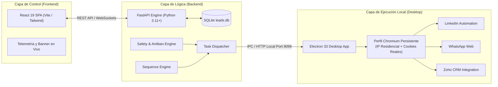
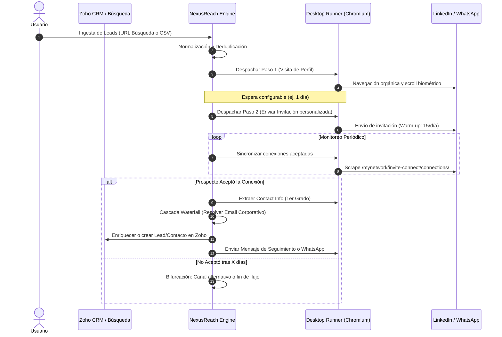
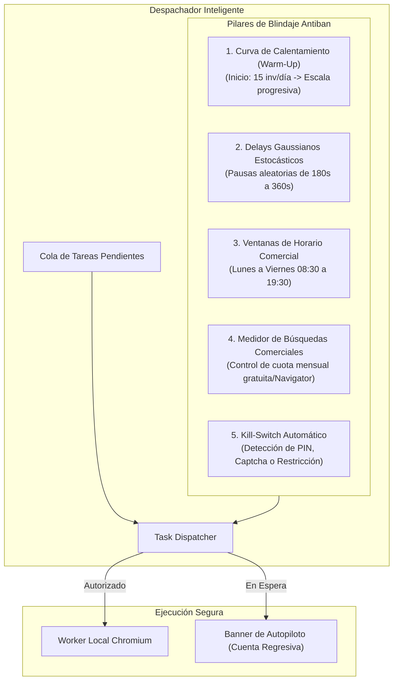

# NexusReach Pro — Suite Integral de Prospección B2B Multicanal
> **Documento de Arquitectura, Funcionamiento y Flujo Operativo de Principio a Fin**  
> *Versión 1.0 — Guía de Arquitectura y Negocio (3 Páginas)*

---

## 📑 PÁGINA 1: Visión General, Propósito y Arquitectura Tecnológica Híbrida

### 1. ¿Qué es NexusReach Pro y qué problema resuelve?
**NexusReach Pro** es una plataforma de software diseñada para automatizar y escalar la prospección comercial B2B hacia directivos y tomadores de decisión. Integra en un solo ecosistema el alcance multicanal (**LinkedIn**, **WhatsApp Web** y **Correo Electrónico Corporativo**) con enriquecimiento automático de datos y sincronización bidireccional hacia **Zoho CRM**.

En las operaciones comerciales B2B tradicionales, la prospección manual es lenta, repetitiva e inconsistente. Por otro lado, las herramientas SaaS en la nube tradicionales suelen provocar bloqueos y suspensiones de cuentas en LinkedIn porque operan desde servidores remotos (IPs de datacenters) con huellas digitales anómalas fácilmente detectables por los algoritmos de seguridad de las plataformas.

**NexusReach Pro resuelve este dilema mediante una arquitectura híbrida local/nube:** centraliza la lógica comercial y las secuencias en un motor inteligente, mientras que la interacción física con las plataformas se ejecuta localmente desde la propia máquina del usuario, utilizando su dirección IP residencial, sus sesiones activas y su huella biométrica real de navegación.



---

### 2. Capas del Sistema y Componentes Tecnológicos

#### A. Capa de Lógica y Persistencia (Backend FastAPI + SQLite)
- Implementado en Python bajo `FastAPI` (puerto `8000`), orquesta todas las reglas de negocio, endpoints REST y estado relacional en la base de datos `leads.db`.
- Aloja los submódulos especializados:
  - `sequence_engine.py`: Administra el árbol de pasos, estados y transiciones de cada campaña.
  - `task_dispatcher.py`: Evalúa la cola de prospectos y despacha tareas atómicas respetando las ventanas de seguridad.
  - `safety_engine.py`: Supervisa límites diarios, curvas de aceleración y algoritmos antiban.
  - `connection_sync_service.py` y `email_resolver_service.py`: Detectan aceptaciones y descubren correos corporativos en cascada.

#### B. Capa de Ejecución Autónoma (Desktop Runner en Electron)
- Construido en `Electron 33` (`desktop/main.cjs` y `worker_runner.cjs`), este componente corre en segundo plano como una aplicación de escritorio nativa.
- Crea y mantiene una partición aislada y persistente de Chromium (`nexusreach_work_session`). En esta partición residen las sesiones abiertas y autenticadas de LinkedIn, WhatsApp Web y Zoho CRM.
- Al recibir una tarea del dispatcher, el runner realiza clics reales, scroll natural y digitación humana con latencias biométricas, garantizando que para LinkedIn el tráfico sea 100% indistinguible de un usuario real.

#### C. Capa de Control y Experiencia de Usuario (Frontend React 19)
- Interfaz de usuario monoplano (SPA) desarrollada con React 19, compilada con Vite y servida tanto en navegador web como embebida en la ventana de Electron.
- Ofrece vistas especializadas para: Dashboard de conversión, Embudo de Prospectos (*Leads View*), Diseñador de Secuencias (*Sequences View*), Consola de Telemetría (*Autopilot Banner*), Registro Forense de Logs y Configuración de Blindaje.

---

## 📑 PÁGINA 2: Ciclo de Vida del Prospecto y Módulos Operativos Clave

El flujo de prospección en NexusReach Pro recorre 5 fases claramente estructuradas, asegurando que ningún contacto se pierda y que cada interacción ocurra en el momento oportuno.



---

### 1. Ingesta, Normalización y Segmentación de Audiencias
- **Fuentes de Entrada:** Los prospectos ingresan mediante tres vías: importación directa desde URLs de búsqueda avanzada o Sales Navigator de LinkedIn, carga de listas en formato CSV, o ingesta desde vistas personalizadas de Zoho CRM.
- **Normalización Inmediata:** El sistema limpia nombres propios, remueve emojis o títulos profesionales en el campo de nombre (evitando saludos artificiales como *"Hola Lic. Juan"*), identifica la empresa actual, el cargo y extrae el identificador público (`public_identifier`).
- **Deduplicación:** Antes de ingresar a una secuencia, el sistema verifica que el prospecto no haya sido contactado previamente ni exista registrado como duplicado inactivo en Zoho CRM.

### 2. Motor de Secuencias Multicanal y Bifurcación Condicional
- **Árbol de Pasos Visuales:** Las campañas se organizan en secuencias estructuradas con demoras relativas (ej. *Paso 1: Visitar Perfil → Esperar 1 día → Paso 2: Enviar Invitación con Nota → Esperar hasta 5 días*).
- **Lógica de Bifurcación (*If / Else*):** El motor evalúa continuamente el estado del prospecto:
  - **Rama Positiva (Aceptó la conexión):** Se cancelan los recordatorios de invitación y se activan los pasos de nutrición: extracción de datos de 1er grado, mensaje de agradecimiento en LinkedIn y sincronización de estado positivo en Zoho.
  - **Rama Alternativa / Contingencia:** Si tras un período predefinido la invitación no es aceptada, la secuencia puede derivar el prospecto a un canal alternativo (como envío de mensaje por WhatsApp Web si se dispone del teléfono móvil) o marcar la salida limpia de la secuencia sin insistencia invasiva.

### 3. Monitoreo Autónomo de Conexiones de 1er Grado
- El servicio en segundo plano `connection_sync_service.py` audita periódicamente la sección nativa de conexiones de LinkedIn (`/mynetwork/invite-connect/connections/`).
- Al detectar que un prospecto invitado figura en el listado reciente de conexiones, actualiza su estado de `INVITACION_ENVIADA` a `CONECTADO`.
- Inmediatamente después, el worker abre el modal nativo de *"Información de contacto"* del perfil y extrae datos confidenciales expuestos solo a conexiones directas: **correos electrónicos personales/profesionales**, **números de teléfono móvil**, perfiles de Twitter/X y sitios web corporativos.

### 4. Motor Waterfall de Enriquecimiento de Correos (Email Resolver)
Cuando el prospecto no expone su correo directamente en LinkedIn, entra en acción el módulo en cascada `email_resolver_service.py`:
1. **Detección de Dominio Corporativo:** A partir del nombre de la empresa del prospecto, determina el dominio oficial web (ej. `empresa.com`).
2. **Generación de Matrices de Patrones:** Genera las combinaciones estándar más probables basadas en nombre y apellido (`nombre.apellido@empresa.com`, `n.apellido@empresa.com`, `napellido@empresa.com`, etc.).
3. **Validación Criptográfica y de Red (DNS MX & SMTP Handshake):** Consulta los servidores de correo (registros MX) del dominio y realiza una verificación SMTP pasiva (emulando el saludo `HELO/EHLO` y `RCPT TO`), confirmando la existencia del buzón sin llegar a enviar ningún correo real (cero riesgo de spam o penalización de reputación).

### 5. Integración y Sincronización con Zoho CRM
- A través de `zoho_browser_service.py`, NexusReach Pro se comunica con la instancia activa de Zoho CRM del usuario.
- Audita si el prospecto ya existe en la base de datos corporativa para evitar colisiones de representantes de venta, actualiza el estado comercial (`Lead_Status`), inyecta los correos descubiertos y deja trazabilidad histórica de cada interacción en las notas del registro.

---

## 📑 PÁGINA 3: Blindaje de Seguridad Antiban, Autopiloto y Telemetría

La viabilidad a largo plazo de cualquier sistema de prospección radica en la protección de los activos digitales del usuario: su perfil de LinkedIn y la reputación de su dominio. NexusReach Pro fue concebido con una política de seguridad estricta de *"Seguridad Primero"* (*Safety-First Architecture*).



---

### 1. Sistema de Blindaje y Reglas Antiban (`safety_engine.py`)

1. **Curva de Calentamiento Gradual (*Warm-up Ramp*):**
   - Para cuentas nuevas o reactivadas, el sistema no lanza cargas masivas de golpe. Comienza con un tope seguro (actualmente calibrado en **15 invitaciones diarias** en su fase inicial) y escala progresivamente semana a semana (18, 22 y 25 acciones/día) a medida que el índice de aceptación se consolida.
2. **Retardos Gaussianos Estocásticos (*Human-Like Delays*):**
   - Los bots ordinarios operan a intervalos fijos y predecibles (ej. exactamente cada 60 segundos), lo que activa las alarmas de LinkedIn. 
   - NexusReach Pro aplica una distribución normal gaussiana con demoras aleatorias que oscilan entre **180 y 360 segundos** entre acciones directas, intercalando micro-pausas de lectura, desplazamientos de página irregulares y movimientos de cursor que reproducen el comportamiento orgánico.
3. **Ventanas de Horario Laboral y Días Hábiles:**
   - La ejecución se bloquea fuera de horarios comerciales habituales (por defecto de lunes a viernes de 08:30 a 19:30). Ninguna invitación ni mensaje se emite en horarios sospechosos (madrugadas o fines de semana).
4. **Kill-Switch y Protección de Sesión:**
   - Si LinkedIn presenta un checkpoint de seguridad (código por correo, CAPTCHA o aviso de límite semanal alcanzado), el despachador detiene inmediatamente el autopiloto, congela la cola de tareas y notifica al usuario en pantalla, evitando bloqueos permanentes de cuenta.

---

### 2. Autopiloto Inteligente y Telemetría en Tiempo Real

El control operativo del sistema está respaldado por componentes diseñados para dar transparencia absoluta al usuario sin necesidad de vigilar la pantalla:

```
┌────────────────────────────────────────────────────────────────────────────────────────┐
│  ▶ PILOTO AUTOMÁTICO ACTIVO                 [ Pausa de Seguridad: 02:45 restantes ]   │
│  Acción actual: Esperando intervalo seguro antes de visitar perfil de Sandra Navarro   │
│  Progreso diario: [████████████░░░░░░░░] 10/15 invitaciones       [ ⏩ Adelantar Pausa ] │
└────────────────────────────────────────────────────────────────────────────────────────┘
```

- **Banner Reactivo en Vivo (`AutopilotBanner.jsx`):**
  - Muestra un temporizador regresivo segundo a segundo (`MM:SS`) indicando el tiempo exacto que el motor esperará antes de disparar el próximo evento.
  - Describe en lenguaje natural el micro-paso que se está ejecutando (*"Navegando al perfil..."*, *"Localizando botón Conectar..."*, *"Pausa de seguridad estocástica..."*).
  - Incluye controles manuales inmediatos: botón para **Adelantar la pausa** de forma segura si el usuario desea forzar la acción, o **Pausar/Reanudar** el flujo global en cualquier instante.
- **Consola de Auditoría y Logs Forenses (`system_logs`):**
  - Cada evento registra marca de tiempo (`timestamp`), nivel de severidad (`INFO`, `WARNING`, `SUCCESS`, `ERROR`), canal de origen (`LinkedIn`, `WhatsApp`, `Zoho`, `System`) y el detalle pormenorizado del resultado (ej. *ID de contacto, URL visitada, estado HTTP devuelto, tiempo de respuesta*).

---

### 3. Matriz Comparativa y Síntesis Ejecutiva

| Dimensión Operativa | Enfoque Tradicional / SaaS en la Nube | Enfoque NexusReach Pro |
| :--- | :--- | :--- |
| **Punto de Ejecución** | Servidores remotos compartidos (IP Datacenter). | **Nativo en máquina local (IP residencial propia vía Electron).** |
| **Riesgo de Bloqueo** | Alto (Detección de patrones y huella de servidor). | **Mínimo (Huella biométrica, delays gaussianos y warm-up).** |
| **Canales Cubiertos** | Usualmente solo LinkedIn o solo Email. | **Triada integrada: LinkedIn + WhatsApp Web + Email Waterfall.** |
| **Gestión de Datos** | Datos dispersos en hojas de cálculo. | **Sincronización directa y enriquecimiento hacia Zoho CRM.** |
| **Control del Operador** | Caja negra sin visibilidad en tiempo real. | **Telemetría viva, cuenta regresiva y logs forenses completos.** |

---
*Documento generado para NexusReach Pro — Todos los derechos reservados.*
