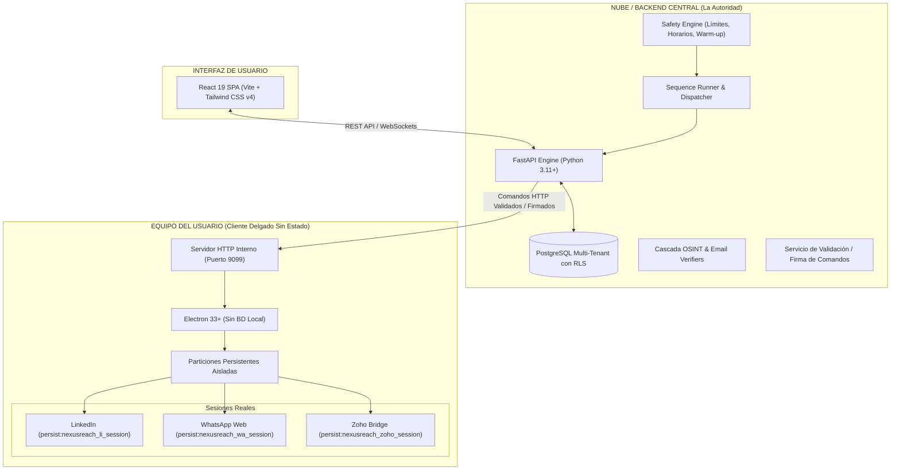

# NexusReach Pro — Guía de Contexto del Proyecto para Inteligencias Artificiales

> **Documento de Contexto Operativo y Arquitectura**  
> *Versión 1.3 — Actualizado a Octubre 2026*  
> Diseñado para ser entregado como prompt de sistema, contexto de repositorio o briefing inicial para modelos de lenguaje e inteligencias artificiales de asistencia técnica (Claude, ChatGPT, Cursor, Copilot, Antigravity, etc.).

---

## 1. Visión General del Producto

**NexusReach Pro** es una suite de software B2B de prospección y alcance (*outreach*) multicanal automatizado (**LinkedIn**, **WhatsApp Web** y **Correo Electrónico Corporativo con Google Workspace**) con enriquecimiento OSINT y verificación de correos en cascada.

- **Mercado Inicial:** Usuarios y equipos de prospección comercial en Latinoamérica (iniciando en Chile) que requieren prospectar perfiles directivos y combinar LinkedIn con WhatsApp y Correo.
- **Modelo de Negocio:** Suscripción mensual plana (15 USD/mes por cuenta conectada de LinkedIn) con todas las funciones incluidas; la escala comercial se basa en cuentas adicionales y consumo de créditos medidos para verificación de correo.
- **Arquitectura Híbrida:**
  1. **Nube / Backend (La Autoridad):** Aloja la lógica de negocio, colas de tareas, motor de secuencias, dispatcher, motor de seguridad (*safety engine*), enriquecimiento de correos, facturación y aislamiento multi-tenant.
  2. **Cliente de Escritorio (Electron — Cliente Delgado Sin Estado):** No almacena bases de datos ni información de leads en disco. Únicamente ejecuta comandos autorizados sobre una partición Chromium local persistente donde residen las sesiones reales del usuario (cookies de LinkedIn y WhatsApp Web).

---

## 2. Diagrama de Arquitectura



---

## 3. Stack Tecnológico

- **Backend:** Python 3.11+, FastAPI, Uvicorn, SQLite (migrando a PostgreSQL multi-tenant con RLS), Pydantic v2, HTTPX, APScheduler.
- **Cliente de Escritorio:** Electron (`desktop/main.cjs`), Node.js, Chromium aislado con particiones de sesión persistentes. Servidor HTTP interno de automatización en `http://127.0.0.1:9099`.
- **Frontend:** React 19, Vite, Tailwind CSS v4, Lucide React. UI estilo SPA con tema oscuro profesional (Linear/Stripe inspired), servida estáticamente desde `static/dist/`.
- **Canales de Prospección:**
  - *LinkedIn:* Automatización sobre navegador real con sesiones locales del usuario.
  - *WhatsApp Web:* Automatización local en Chromium sin usar API no oficial ni arriesgar el número en la nube. Solo para contactos cálidos/aceptados.
  - *Correo Corporativo:* Envío directo vía Google Workspace / Gmail API con autenticación OAuth del usuario.
  - *Zoho Bridge:* Automatización transitoria de interfaz en partición aislada para reflejar datos sin usar API OAuth directa.

---

## 4. Módulos y Capacidades del Sistema

### A. Secuencias y Outreach Multicanal (`sequence_runner.py`, `SequencesView.jsx`)
- Diseñador visual de secuencias con pasos configurables, retardos temporales (horas/días) y bifurcaciones condicionales (ej. "¿Aceptó invitación?", "¿Abrió correo?").
- Pasos soportados:
  - `VISITAR_PERFIL`: Visita orgánica de perfil en LinkedIn.
  - `ENVIAR_INVITACION`: Solicitud de conexión con nota personalizada (soporta Spintax).
  - `ENVIAR_MENSAJE_LINKEDIN`: Mensaje directo para contactos de 1º grado.
  - `ENVIAR_WHATSAPP_WEB`: Mensaje conversacional vía WhatsApp Web con pausas antiban.
  - `ENVIAR_CORREO_WORKSPACE`: Envío de email corporativo con seguimiento.
  - `ESPERAR`: Pausas programadas para enfriamiento.
- Runner local en segundo plano con "Piloto Automático", despacho escalonado y control de concurrencia.

### B. Motor Antiban y Protección de Cuentas (`safety_engine.py`, `AntibanSettingsModal.jsx`)
- **El servidor manda:** Límites diarios estrictos, ventanas de horario hábil según zona horaria del usuario, pausas orgánicas y curvas graduales de calentamiento (*warm-up*).
- **Emulación humana:** Movimiento de ratón mediante curvas Bézier, jitter de retardo aleatorio entre pulsaciones de teclas, tiempos de scroll orgánico y variabilidad de pausas.
- Detección reactiva de checkpoints (desconexión, captcha o advertencias) con detención de emergencia (*kill-switch*) automática.

### C. Enriquecimiento y Cascada de Correos (`email_resolver_service.py`)
- Extracción de datos públicos y de contacto de perfiles de 1º grado sin inyección de scripts externos.
- Resolución de correos corporativos en cascada:
  1. Scraping OSINT en sitios web institucionales y fuentes públicas.
  2. Generación sintáctica de patrones de dominio (`nombre.apellido@empresa.com`, etc.).
  3. Verificación de servidores MX y formato SMTP.
  4. Respaldo opcional con servicios de pago (Hunter, Snov, Anymail Finder) descontando créditos medidos.

### D. Multi-Tenancy y Gestión de Cuentas (`tenants`, `workspaces`)
- Aislamiento total de prospectos, listas y métricas por cada `tenant_id`.
- Panel administrativo para agencias y multi-cuenta (SuperAdmin, Portal de Clientes, cambio rápido de espacios de trabajo).

### E. Módulo Zoho Bridge Transitorio (`desktop/main.cjs`, `zoho_bridge_service.py`)
- Módulo puente transitorio en una partición de Chromium aislada (`persist:nexusreach_zoho_session`).
- Opera estrictamente mediante comandos cerrados precompilados (`ZOHO_FIND_LEAD`, `ZOHO_UPSERT_LEAD`, `ZOHO_SET_STATUS`, `ZOHO_ADD_NOTE`).
- El estado y la bitácora viven en la base de datos propia de NexusReach; Zoho es solo una réplica opcional.

---

## 5. Reglas de Oro y Directrices de Ingeniería Obligatorias (Directrices v1.3)

Cualquier agente de IA que colabore en este repositorio **DEBE** respetar estrictamente estas directrices:

1. **PROHIBICIÓN ESTRICTA de inyección de JavaScript libre en Electron (C-01):**
   - **NUNCA** utilices `evaluate`, `executeJavaScript` con strings dinámicos de código JS ni llamadas del tipo `_call_mcp_evaluate` hacia el Chromium de Electron.
   - Toda interacción con la página (clicks, lectura de datos, scroll) debe ejecutarse a través de los **endpoints seguros y precompilados** expuestos por `desktop/main.cjs` (ej: `/extract/contact-info`, `/network/extract`, `/navigate`, `/click`).
2. **El backend es la única autoridad:**
   - El cliente de escritorio Electron no toma decisiones de negocio, no calcula límites ni elige qué prospecto contactar; solo ejecuta la instrucción autorizada y devuelve el resultado.
3. **Cero persistencia de leads en el cliente local:**
   - La información de los prospectos no se almacena en el disco del cliente (no hay SQLite ni JSONs en local). Los datos viven en memoria durante la tarea y se descartan.
4. **Fuera de alcance (NO implementar):**
   - **NO** implementar la API oficial OAuth de Zoho CRM ni de otros CRM.
   - **NO** implementar la API oficial de WhatsApp Business (Meta Graph). WhatsApp opera únicamente por el navegador local Chromium.
   - **NO** diseñar modelos de precios con funciones bloqueadas; la plataforma tiene oferta plana con medición de créditos de correo.
5. **No dejar código huérfano:**
   - Al retirar un flujo obsoleto, se deben eliminar de raíz los botones en el frontend, las funciones en `api.js` y los endpoints o modelos en desuso en el backend.
6. **Integridad del build frontend:**
   - Cualquier cambio en `frontend/` debe ser validado ejecutando `npm run build` para garantizar que no existan errores de Rollup/Vite y que el bundle estático en `static/dist/` quede sincronizado.

---

## 6. Estructura del Repositorio y Puntos de Entrada

```
.
├── main.py                                      # Servidor FastAPI (Rutas REST, control de servicios, static files)
├── browser_service.py                           # Cliente HTTP que despacha acciones al Electron local (:9099)
├── sequence_runner.py                           # Ciclo de ejecución automática de secuencias (worker loop)
├── safety_engine.py                             # Motor antiban, límites diarios, horarios y warm-up
├── email_resolver_service.py                    # Cascada de resolución y enriquecimiento de correos
├── connection_sync_service.py                   # Sincronización de red y contactos de 1º grado de LinkedIn
├── models.py / schemas.py                       # Modelos de base de datos y esquemas Pydantic
├── desktop/
│   ├── main.cjs                                 # Proceso principal de Electron, BrowserWindow y API interna :9099
│   ├── package.json
│   └── tests/test_security_subsystem.cjs        # Suite de pruebas automatizadas del canal seguro
├── frontend/
│   ├── src/
│   │   ├── App.jsx                              # Punto de entrada de la UI, estado de sesión y enrutamiento por pestañas
│   │   ├── components/
│   │   │   ├── Sequences/                       # SequencesView.jsx, NewSequenceModal.jsx, AddStepModal.jsx
│   │   │   ├── Prospects/                       # LeadsDirectoryView.jsx, UnifiedLeadsTable.jsx, LeadModal.jsx
│   │   │   ├── Lists/                           # ListsView.jsx, NewListModal.jsx
│   │   │   ├── Antiban/                         # AntibanSettingsModal.jsx, SafetyBanner.jsx
│   │   │   └── Agency/                          # Portal multi-cliente (AgencyPortalView.jsx, SuperAdminView.jsx)
│   │   └── services/api.js                      # Cliente Fetch centralizado hacia el backend FastAPI
│   ├── vite.config.js
│   └── package.json
├── static/dist/                                 # Build de producción de la UI servido directamente por FastAPI
└── NexusReach_Pro_Directrices_para_Agentes_v1.3.md # Especificación técnica normativa y vinculante
```

---

## 7. Instrucciones para el Asistente de IA

Cuando trabajes en este código:
1. **Mentalidad de Seguridad Primero:** Verifica siempre que las interacciones con LinkedIn y WhatsApp cumplan con los márgenes antiban y no utilicen código ejecutable arbitrario.
2. **Ediciones Quirúrgicas:** Realiza cambios precisos, preservando comentarios existentes y lógica circundante.
3. **Respeto a las Directrices v1.3:** Si una solicitud entra en conflicto con las directrices normativas, adviértelo con fundamentos técnicos antes de proceder.
4. **Validación:** Tras modificar código en `frontend/`, compila con `npm run build` y ejecuta las pruebas necesarias para certificar la ausencia de regresiones.
