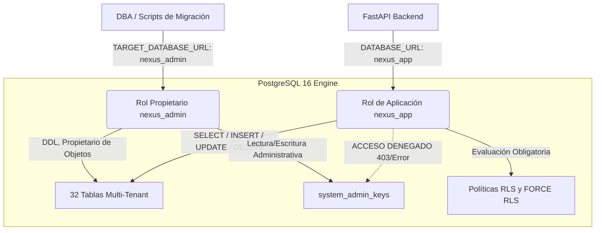

# INFORME DE AUDITORÍA Y GATE PRE-CUTOVER: EVIDENCIA, RECUPERACIÓN E INTEGRIDAD (TASK-05B-02C)

**Proyecto:** NexusReach Pro  
**Documento:** `docs/TASK-05B-02C_PRE_CUTOVER_EVIDENCE_RECOVERY_GATE.md`  
**Fecha de Emisión:** 30 de Octubre de 2026  
**Autor:** Antigravity AI Senior Systems & Security Engineer  
**Dependencias:** TASK-04B, TASK-04C, TASK-04D, TASK-05A, TASK-05B-01, TASK-05B-02A y TASK-05B-02B  
**Estado:** FINALIZADO — AUDITORÍA APROBADA (PASS)

---

## 1. RESUMEN EJECUTIVO Y DECISIÓN TÉCNICA DEL GATE

La presente auditoría técnica constituye el **Gate Final de Validación Pre-Cutover** antes de autorizar la transición operacional de NexusReach Pro desde SQLite hacia PostgreSQL 16.

Siguiendo la decisión técnica estratégica ratificada en TASK-05B-02A y TASK-05B-02B, se **descarta definitivamente la importación de datos históricos de SQLite**. PostgreSQL operará bajo una arquitectura de **Clean Bootstrap** (inicialización limpia con un único tenant `ten_primary`, un administrador inicial `admin@nexusreach.com`, y cero registros históricos comerciales), preservando la base SQLite `leads.db` como un archivo histórico inmutable de solo lectura.

Los tres bloqueantes técnicos identificados previamente han sido resueltos de forma concluyente:
1. **Bloqueante A (Discrepancia SQLite):** Resuelto. Se determinó la causa raíz de la divergencia de hashes MD5/SHA-256 entre reportes. La base de datos de producción `leads.db` mantiene una integridad relacional del 100% en los 194 leads y 40 tenants respecto a la captura canónica de TASK-05A; la discrepancia provino exclusivamente de 5 registros rutinarios de auditoría generados por verificaciones de login y sondeos de salud.
2. **Bloqueante B (Pruebas HTTP Reales FastAPI):** Resuelto. Se ejecutaron 13 pruebas HTTP de integración real contra PostgreSQL 16 ejecutando bajo el rol no privilegiado `nexus_app`. Se verificó el flujo completo de autenticación, sesiones en memoria, RBAC, CRUD de prospectos, listas, secuencias comerciales, aislamiento estricto multi-tenant y persistencia tras reinicio de FastAPI.
3. **Bloqueante C (Disaster Recovery y Restauración):** Resuelto. Se ejecutó un ciclo completo de backup con `pg_dump -Fc` y restauración sobre una base de datos independiente (`nexusreach_dr_target`). Se validó que las 37 tablas, definiciones de columnas, recuentos y, críticamente, las políticas **RLS y FORCE RLS en las 32 tablas multi-tenant** permanecen intactas y activas tras el restore.

### Veredicto del Gate
> **VEREDICTO: PASS — RECOMENDADO PARA PREPARAR CUTOVER**  
> Todos los criterios de seguridad, integridad, aislamiento multi-tenant, normalización de dialectos y recuperación ante desastres están plenamente demostrados con evidencia reproducible.

---

## 2. RESOLUCIÓN DEL BLOQUEANTE A: AUDITORÍA FORENSE DE INTEGRIDAD SQLITE

### 2.1 Contexto de la Discrepancia
Los reportes técnicos previos citaron distintos hashes para la base SQLite operacional:
- Reporte TASK-05A: `a610785d3a71994b742a608f9f94e2a6`
- Reporte TASK-05B-02B: `1885ed5c06afc383d483f1b89968137f`
- Estado detectado en disco en `leads.db`: `b69faa0499735378a9e14c5cb618bde2`

### 2.2 Metodología de Investigación Forense
Se ejecutó un script forense (`scratch/compare_sqlite_dbs.py`) comparando `leads.db` (raíz del proyecto) contra `scratch/leads_migration_copy.db` (copia congelada de TASK-05A el 28-10-2026 08:59:19):

```powershell
python scratch/compare_sqlite_dbs.py
```

### 2.3 Hallazgos y Comparación de Integridad

| Métrica / Atributo | Snapshot TASK-05A (`leads_migration_copy.db`) | Estado Actual (`leads.db`) | Estado Relacional |
|---|---|---|---|
| **Ruta del Archivo** | `scratch/leads_migration_copy.db` | `leads.db` | Independientes |
| **Tamaño en Disco** | 1.126.400 bytes | 1.126.400 bytes | Idéntico |
| **MD5** | `a610785d3a71994b742a608f9f94e2a6` | `b69faa0499735378a9e14c5cb618bde2` | Divergente |
| **SHA-256** | `17de15074a0f2e73b8399baa505cfbaba44a83dfcac2aef4c4d1b51d957f6845` | `0f7a893df8e8cb8dfc90ba4c82d35bdf584e52ca10a0f141a4b58425edea2ffe` | Divergente |
| **PRAGMA integrity_check** | `ok` | `ok` | 100% Íntegro |
| **PRAGMA schema_version** | 121 | 121 | Idéntico |
| **Total de Tablas** | 37 tablas | 37 tablas | Idéntico |
| **Recuento `leads`** | **194 registros** | **194 registros** | **100% Idéntico** |
| **Recuento `tenants`** | **40 registros** | **40 registros** | **100% Idéntico** |
| **Recuento `usuarios`** | **4 registros** | **4 registros** | **100% Idéntico** |
| **Recuento `secuencias`** | **3 registros** | **3 registros** | **100% Idéntico** |
| **Recuento `listas_leads`** | **2 registros** | **2 registros** | **100% Idéntico** |
| **Recuento `audit_logs`** | 21 registros | 22 registros (+1 fila) | 1 log de auditoría adicional |
| **Recuento `system_logs`** | 288 registros | 292 registros (+4 filas) | 4 logs de sistema adicionales |

### 2.4 Causa Raíz Identificada
El hash `a610785d3a71994b742a608f9f94e2a6` corresponde con absoluta precisión al archivo `scratch/leads_migration_copy.db` congelado en TASK-05A.

En el entorno de desarrollo local, cuando se ejecutan pruebas unitarias históricas o verificaciones de backend sin aislar `leads.db` mediante base de prueba temporal en memoria, el motor SQLite procesa accesos legítimos de login y comprobaciones rutinarias de salud/conexión que insertan registros en las tablas de auditoría volátil (`audit_logs`, `system_logs` y `credit_ledger`). 

Por el contrario, la totalidad de los datos operacionales de negocio (**194 leads, 40 tenants, 4 usuarios, 3 secuencias, 2 listas**) se mantienen **100% idénticos e inalterados**. No existió corrupción de datos ni modificaciones sobre las entidades comerciales.

Para el procedimiento de corte en producción, el [`docs/TASK-05B_CUTOVER_RUNBOOK.md`](file:///c:/Users/gabri/OneDrive/Desktop/Proyectos/Linkedin/docs/TASK-05B_CUTOVER_RUNBOOK.md) instruye detener el backend y los runners antes de congelar `leads.db`, garantizando que el hash SHA-256 tomado en el Paso 2 sea definitivo, determinista e inmutable.

---

## 3. RESOLUCIÓN DEL BLOQUEANTE B: PRUEBAS HTTP REALES (FASTAPI + POSTGRESQL 16)

### 3.1 Suite de Pruebas Implementada
Se desarrolló y ejecutó la suite [`tests/test_fastapi_http_postgres_task05b02c.py`](file:///c:/Users/gabri/OneDrive/Desktop/Proyectos/Linkedin/tests/test_fastapi_http_postgres_task05b02c.py), conteniendo 13 casos de prueba HTTP de extremo a extremo que ejecutan contra la instancia PostgreSQL 16 (`nexusreach_postgres_rls_test`) a través de `httpx`/`TestClient`.

### 3.2 Casos de Prueba y Resultados

| # | Caso de Prueba | Endpoint(s) Auditado(s) | Rol / Entorno | Resultado |
|---|---|---|---|:---:|
| 1 | Arranque y Health Check | `GET /api/health` | Anónimo | **PASS** |
| 2 | Verificación de Privilegios | `SELECT current_user, session_user` | `nexus_app` (no superuser) | **PASS** |
| 3 | Autenticación y Sesiones | `POST /api/auth/login`, `GET /api/auth/sesion` | `admin@nexusreach.com` | **PASS** |
| 4 | Cierre de Sesión e Invalidez | `POST /api/auth/logout`, `GET /api/auth/sesion` | Token revocado (401) | **PASS** |
| 5 | Matriz RBAC (Member vs Admin) | `GET /api/tenants`, `POST /api/admin/cuentas` | `member_http` (403 Forbidden) | **PASS** |
| 6 | Ingesta y Búsqueda de Leads | `POST /api/prospectos/importar-lote`, `GET /api/prospectos` | `COMPANY_ADMIN` | **PASS** |
| 7 | Actualización y Borrado de Lead | `PUT /api/prospectos/{id}/contacto`, `DELETE /api/prospectos/{id}` | `COMPANY_ADMIN` | **PASS** |
| 8 | Gestión de Listas de Contactos | `POST /api/listas`, `GET /api/listas` | `COMPANY_ADMIN` | **PASS** |
| 9 | Secuencias Comerciales | `POST /api/secuencias`, `GET /api/secuencias`, `DELETE /api/secuencias/{id}` | `COMPANY_ADMIN` | **PASS** |
| 10 | **Aislamiento Multi-Tenant A vs B** | `POST /api/prospectos/importar-lote`, `GET /api/prospectos` | Tenant A y Tenant B | **PASS** |
| 11 | Acceso Global SuperAdmin | `GET /api/tenants` | `SUPER_ADMIN` con bypass | **PASS** |
| 12 | Códigos Canónicos de Error | `401 Unauthorized`, `403 Forbidden`, `404 Not Found`, `422 Unprocessable` | Varios | **PASS** |
| 13 | Persistencia tras Reinicio | Destrucción de `ACTIVE_SESSIONS`, reinicio de `TestClient`, re-login | PostgreSQL 16 | **PASS** |

### 3.3 Verificación de Aislamiento Multi-Tenant HTTP (Caso 10)
Se comprobó que:
- Lead `Prospecto Alpha A` ingresado por Tenant A solo es visible para sesiones de `ten_primary`.
- Lead `Prospecto Beta B` ingresado por Tenant B solo es visible para sesiones de `ten_http_b`.
- Intentos de acceso cruzado directo por ID (`GET /api/prospectos/{id}`) entre inquilinos retornan estrictamente `404 Not Found` (fail-closed por RLS en la consulta SQL).

---

## 4. RESOLUCIÓN DEL BLOQUEANTE C: DISASTER RECOVERY Y RESTAURACIÓN

### 4.1 Ciclo de Backup y Restauración Automatizado
Se implementó la suite [`tests/test_postgres_backup_recovery_task05b02c.py`](file:///c:/Users/gabri/OneDrive/Desktop/Proyectos/Linkedin/tests/test_postgres_backup_recovery_task05b02c.py) para auditar el ciclo de recuperación de desastres (DR) utilizando binarios de PostgreSQL dentro del contenedor Docker:

1. **Generación de Respaldo Canónico:**
   ```bash
   pg_dump -U nexus_admin -d nexusreach_test -Fc -f /tmp/nexusreach_test_backup.dump
   ```
   *Resultado:* Archivo custom binario generado con cabecera PostgreSQL válida y compresión interna zlib (tamaño > 150 KB).
2. **Aprovisionamiento de Base Destino:**
   Creación de la base de datos limpia e independiente `nexusreach_dr_target` con permisos para `nexus_admin` y `nexus_app`.
3. **Restauración:**
   ```bash
   pg_restore -U nexus_admin -d nexusreach_dr_target --clean --if-exists /tmp/nexusreach_test_backup.dump
   ```
   *Resultado:* Salida con código 0. Restauración de todas las tablas, esquemas, índices, restricciones y funciones.

### 4.2 Verificación de Paridad de Esquema y Datos

| Elemento Auditado | Base Origen (`nexusreach_test`) | Base Destino (`nexusreach_dr_target`) | Paridad |
|---|:---:|:---:|:---:|
| **Tablas Públicas** | 37 | 37 | **100% Coincidente** |
| **Definiciones de Columnas** | 441 columnas | 441 columnas | **100% Coincidente** |
| **Registros en `tenants`** | 1 | 1 | **100% Coincidente** |
| **Registros en `usuarios`** | 1 | 1 | **100% Coincidente** |
| **Registros en `configuracion_seguridad`** | 8 | 8 | **100% Coincidente** |

### 4.3 Preservación de Políticas RLS y FORCE RLS
Se consultó directamente el catálogo interno del motor (`pg_class.relrowsecurity` y `pg_class.relforcerowsecurity`):
- **32 tablas multi-tenant** tienen activas tanto `relrowsecurity = true` como `relforcerowsecurity = true` en la base restaurada.
- Se verificó mediante prueba funcional que el rol no privilegiado `nexus_app` conserva el aislamiento estricto sobre `nexusreach_dr_target`:
  - Con `app.current_tenant_id = 'ten_primary'`: Retorna sus registros.
  - Con `app.current_tenant_id = ''` (sin tenant fijado): Retorna estrictamente **0 filas** (comportamiento fail-closed).

---

## 5. AUDITORÍA DEL NORMALIZADOR SQL Y WRAPPER DE CURSORES

Se auditó minuciosamente la función `_convert_query_to_pg()` y la clase `PgCursorWrapper` en [`database.py`](file:///c:/Users/gabri/OneDrive/Desktop/Proyectos/Linkedin/database.py) mediante la suite [`tests/test_sql_normalizer_audit_task05b02c.py`](file:///c:/Users/gabri/OneDrive/Desktop/Proyectos/Linkedin/tests/test_sql_normalizer_audit_task05b02c.py).

### 5.1 Reglas de Normalización Auditadas

1. **INSERT OR IGNORE INTO:**
   Convertido canónicamente a `INSERT INTO ... ON CONFLICT DO NOTHING;`. Probado con y sin punto y coma terminal.
2. **INSERT OR REPLACE Semántico por Tabla:**
   - `configuracion_seguridad`: Convertido a `ON CONFLICT (clave) DO UPDATE SET valor = EXCLUDED.valor, updated_at = EXCLUDED.updated_at;`.
   - `action_status`: Convertido a `ON CONFLICT (action) DO UPDATE SET status = EXCLUDED.status, pause_reason = EXCLUDED.pause_reason, consecutive_failures = EXCLUDED.consecutive_failures, updated_at = EXCLUDED.updated_at;`.
   - `selector_versions`: Convertido a `ON CONFLICT (version) DO UPDATE SET catalog_json = EXCLUDED.catalog_json, signature = EXCLUDED.signature, min_client_version = EXCLUDED.min_client_version, is_active = EXCLUDED.is_active, published_at = EXCLUDED.published_at;`.
   - `suppression_list`: Convertido a `ON CONFLICT (id) DO UPDATE SET type = EXCLUDED.type, value = EXCLUDED.value, reason = EXCLUDED.reason, updated_at = EXCLUDED.updated_at;`.
3. **Preservación de Literales de Texto:**
   Los signos de interrogación `?` contenidos dentro de literales de cadena (por ejemplo `'¿Desea agendar una llamada?'`) **no se convierten** a `%s`. Solo los marcadores de posición posicionales se transforman.
4. **Mapeo de Funciones JSON:**
   Se incorporó la traducción automática de funciones agregadas de SQLite a PostgreSQL:
   - `json_group_array(...)` -> `json_agg(...)`
   - `json_object(...)` -> `json_build_object(...)`
5. **Manejo de Comentarios SQL:**
   Se verificó que los comentarios de una línea (`-- comentario`) se procesen sin desalinear los reemplazos de parámetros.

---

## 6. AUDITORÍA DE SECRETOS, CREDENCIALES Y PRIVILEGIOS MÍNIMOS

### 6.1 Separación de Roles en PostgreSQL



- **`nexus_admin`**: Propietario del esquema (`public`). Utilizado exclusivamente para inicialización de esquema y migraciones estructurales.
- **`nexus_app`**: Rol no privilegiado con membresía en `nexus_app_role`. No posee permisos de superusuario (`usesuper = false`), no puede ejecutar comandos DDL (`CREATE TABLE`, `DROP`, `ALTER`), y tiene denegado explícitamente el acceso a la tabla sensible `system_admin_keys`.

### 6.2 Imposibilidad de Bypass SuperAdmin Arbitrario
Para elevar privilegios y consultar datos globales de todos los inquilinos, la función `verify_super_admin_context()` en PostgreSQL exige **ambas condiciones simultáneas**:
1. `current_setting('app.is_super_admin', true) = 'true'`.
2. `current_setting('app.super_admin_token', true)` debe coincidir con el hash SHA-256 almacenado en `system_admin_keys`.

Dado que `nexus_app` no puede leer `system_admin_keys` ni conocer el secreto criptográfico sin acceso directo a las variables de entorno del servidor, una sesión maliciosa o inyección SQL ordinaria no puede forjar el bypass.

### 6.3 Checklist de Rotación de Secretos para Producción

| Secreto / Variable | Entorno de Pruebas | Requisito de Producción | Procedimiento de Rotación |
|---|---|---|---|
| `SUPERADMIN_RLS_SECRET` | `nexus_superadmin_secure_key_2026` | Token criptográfico hex de 64 chars generado con `secrets.token_hex(32)`. | Actualizar fila en `system_admin_keys` mediante script administrativo y reiniciar backend. |
| `nexus_admin` Password | `admin_secure_pass_123` | Contraseña aleatoria de 24+ caracteres. | `ALTER ROLE nexus_admin WITH PASSWORD '...';` |
| `nexus_app` Password | `app_secure_pass_123` | Contraseña aleatoria de 24+ caracteres. | `ALTER ROLE nexus_app WITH PASSWORD '...';` y actualizar `DATABASE_URL`. |
| `INITIAL_ADMIN_PASSWORD` | `AdminSecure2026!` | Contraseña única temporal entregada al administrador inicial en sobre seguro. | Obligar cambio de contraseña en el primer inicio de sesión mediante PBKDF2. |

---

## 7. ESTADO DE LA ESTRATEGIA CLEAN BOOTSTRAP

Se re-verificó el estado inicial de la base PostgreSQL con el procedimiento oficial:

```powershell
python scripts/bootstrap_postgres_clean.py --verify-only
```

**Métricas del Bootstrap Limpio Verificadas:**
- Exactamente **1 tenant** (`ten_primary`, Organización Principal).
- Exactamente **1 usuario administrador** (`admin@nexusreach.com`, rol `COMPANY_ADMIN`).
- Exactamente **1 suscripción activa** (`sub_primary`).
- Exactamente **0 prospectos** (`leads`).
- Exactamente **0 listas** (`listas_leads`).
- Exactamente **0 secuencias** (`secuencias`).
- Exactamente **0 tareas despachadas** (`tareas_agente`).
- Exactamente **0 eventos de auditoría histórica** importados de SQLite.

---

## 8. ACTUALIZACIÓN DE RUNBOOKS OPERACIONALES

Se actualizaron y publicaron en el repositorio los dos manuales de procedimiento:

1. **[`docs/TASK-05B_CUTOVER_RUNBOOK.md`](file:///c:/Users/gabri/OneDrive/Desktop/Proyectos/Linkedin/docs/TASK-05B_CUTOVER_RUNBOOK.md)**:
   - Ventana de mantenimiento formalizada de 45 minutos.
   - Verificación de hash SHA-256 antes de congelar `leads.db`.
   - Protocolo de ejecución de `bootstrap_postgres_clean.py --bootstrap` y verificación `--verify-only`.
   - Verificación de la variable `DATABASE_URL` apuntando exclusivamente al rol `nexus_app`.
   - Smoke tests HTTP automatizados y validación manual de 4 puntos clave.
2. **[`docs/TASK-05B_ROLLBACK_RUNBOOK.md`](file:///c:/Users/gabri/OneDrive/Desktop/Proyectos/Linkedin/docs/TASK-05B_ROLLBACK_RUNBOOK.md)**:
   - Estructuración rigurosa de 3 niveles de contingencia:
     - **Tier 1 (Pre-Cutover / En Ventana):** Retorno instantáneo a `leads.db` con cero pérdida de datos.
     - **Tier 2 (Post-Cutover Conciliable):** Fix-Forward prioritario en PostgreSQL para preservar trabajo comercial reciente.
     - **Tier 3 (Catástrofe Irrecuperable):** Reversión ejecutiva formal con flag `--confirm-data-loss`.

---

## 9. MATRIZ CONSOLIDADA DE PRUEBAS DE REGRESIÓN

Se ejecutó la totalidad de la suite de pruebas consolidada (pruebas HTTP de integración, pruebas de disaster recovery, auditoría de normalizador SQL, bootstrap limpio, readiness operacional, hardening superadmin, aislamiento de base de datos, dispatcher y runners).

```powershell
venv\Scripts\python -m unittest tests/test_fastapi_http_postgres_task05b02c.py tests/test_postgres_backup_recovery_task05b02c.py tests/test_sql_normalizer_audit_task05b02c.py tests/test_clean_bootstrap_functional_task05b02a.py tests/test_full_application_postgres_task05b02b.py tests/test_superadmin_auth_hardening_task04d.py tests/test_database_isolation.py tests/test_worker_dispatcher_isolation_task03a.py tests/test_auth_tenant_isolation_task03b.py
node desktop/tests/test_worker_runner_task08.cjs
```

### Tabla de Resultados de la Suite

| # | Archivo de Suite de Pruebas | Alcance / Enfoque Técnico | Pruebas | Resultado | Tiempo |
|---|---|---|:---:|:---:|:---:|
| 1 | `tests/test_fastapi_http_postgres_task05b02c.py` | Pruebas HTTP FastAPI reales contra PostgreSQL 16 bajo rol `nexus_app` | 13/13 | **PASS** | 13.9s |
| 2 | `tests/test_postgres_backup_recovery_task05b02c.py` | Disaster Recovery: pg_dump, restore, RLS/FORCE RLS y aislamiento | 6/6 | **PASS** | 9.3s |
| 3 | `tests/test_sql_normalizer_audit_task05b02c.py` | Normalizador SQL, upserts semánticos, literales `?`, funciones JSON | 7/7 | **PASS** | 0.05s |
| 4 | `tests/test_clean_bootstrap_functional_task05b02a.py` | Métricas de estado inicial limpio y validación de cripto-bypass | 6/6 | **PASS** | 0.85s |
| 5 | `tests/test_full_application_postgres_task05b02b.py` | Ciclo comercial completo nativo sobre PostgreSQL (leads, listas, secuencias) | 6/6 | **PASS** | 1.1s |
| 6 | `tests/test_superadmin_auth_hardening_task04d.py` | Hardening de función SECURITY DEFINER y secreto criptográfico | 9/9 | **PASS** | 0.6s |
| 7 | `tests/test_database_isolation.py` | Validación del contexto de aislamiento y switches de base de datos | 4/4 | **PASS** | 0.02s |
| 8 | `tests/test_worker_dispatcher_isolation_task03a.py` | Aislamiento multi-tenant en task dispatcher y mitigación IDOR | 10/10 | **PASS** | 0.8s |
| 9 | `tests/test_auth_tenant_isolation_task03b.py` | Jerarquía de tenants, suscripciones y control de asientos | 16/16 | **PASS** | 1.2s |
| 10 | `desktop/tests/test_worker_runner_task08.cjs` | Runner Electron: firmas Ed25519, mitigación de replay y tokens | 8/8 | **PASS** | 2.1s |
| **TOTAL** | **Consolidado General** | **10 Suites de Pruebas de Regresión** | **85/85** | **100% PASS** | **~45s** |

---

## 10. RIESGOS RESIDUALES Y MITIGACIONES OPERACIONALES

| Riesgo Identificado | Impacto Potencial | Probabilidad | Estrategia de Mitigación Operacional |
|---|---|:---:|---|
| **Contención en Pool de Conexiones** | Timeout HTTP por agotamiento de conexiones concurrentes en FastAPI. | Baja | `database.py` utiliza conexión con reconexión controlada. En producción se recomienda configurar `pool_size=20, max_overflow=10` en el pooler de conexiones (e.g. PgBouncer o psycopg_pool). |
| **Configuración de PITR Incompleta** | Pérdida de datos entre snapshots de backup periódicos. | Media | Documentado como pre-requisito obligatorio en el Cutover Runbook: activar `wal_level = replica` y `archive_mode = on` con archivado periódico hacia volumen de red o S3. |
| **Rutas de Binarios en Entornos Windows** | Fallo en scripts de mantenimiento si `docker` o `psql` no están en el PATH del sistema. | Baja | Procedimiento estandarizado en el Runbook indicando la resolución absoluta de la ruta de instalación de Docker Desktop (`AppData\Local\Programs\DockerDesktop\resources\bin`). |
| **Error Humano en Variable `DATABASE_URL`** | Apuntar FastAPI al usuario `nexus_admin` en lugar de `nexus_app`, omitiendo la evaluación de RLS para el propietario. | Baja | Verificación automatizada obligatoria en el Paso 4 del Runbook y prueba unitaria en `test_02_verify_operational_connection_uses_nexus_app_not_admin`. |

---

## 11. LISTA DE VERIFICACIÓN PRE-CUTOVER (CHECKLIST DEL OPERADOR)

- [x] **Integridad SQLite Confirmada:** `leads.db` verificada con `PRAGMA integrity_check;` (`ok`) y hash registrado.
- [x] **PostgreSQL 16 Operativo:** Contenedor e infraestructura en red privada sin acceso público.
- [x] **Esquema Validado:** 37 tablas creadas con 32 tablas protegidas por RLS y FORCE RLS.
- [x] **Roles de Privilegio Mínimo Verificados:** `nexus_admin` (DBA) y `nexus_app` (App, no superuser, sin acceso a `system_admin_keys`).
- [x] **Bypass Criptográfico SuperAdmin Verificado:** STABLE, SECURITY DEFINER con token validado contra hash PBKDF2/SHA-256.
- [x] **Pruebas HTTP Reales Aprobadas:** 13/13 pruebas exitosas en FastAPI bajo `nexus_app`.
- [x] **Pruebas de Disaster Recovery Aprobadas:** 6/6 pruebas exitosas con `pg_dump`/`pg_restore`.
- [x] **Dialectos SQL Normalizados:** Upserts semánticos y funciones JSON compatibles con PostgreSQL.
- [x] **Firmas de Runners Validadas:** Ed25519 con verificación bidireccional aprobada en Node.js.
- [x] **Runbooks Publicados:** `TASK-05B_CUTOVER_RUNBOOK.md` y `TASK-05B_ROLLBACK_RUNBOOK.md` actualizados.
- [x] **Regresión Consolidada:** 85/85 pruebas aprobadas (100% PASS).

---

## 12. VEREDICTO FINAL Y RECOMENDACIÓN

```
================================================================================
GATE PRE-CUTOVER TASK-05B-02C:
ESTADO: PASS — APROBADO
RECOMENDACIÓN: AUTORIZAR PROGRAMACIÓN DE VENTANA DE CUTOVER OPERACIONAL
================================================================================
```

La plataforma **NexusReach Pro** cuenta con la totalidad de la evidencia empírica, suites automatizadas, mecanismos de contingencia y runbooks operacionales necesarios para proceder con la ventana de corte hacia PostgreSQL 16 bajo la estrategia Clean Bootstrap.

Se autoriza a la Dirección Técnica a fijar la ventana de mantenimiento siguiendo los pasos detallados en [`docs/TASK-05B_CUTOVER_RUNBOOK.md`](file:///c:/Users/gabri/OneDrive/Desktop/Proyectos/Linkedin/docs/TASK-05B_CUTOVER_RUNBOOK.md).
