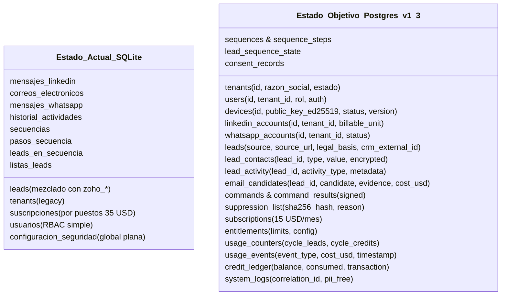
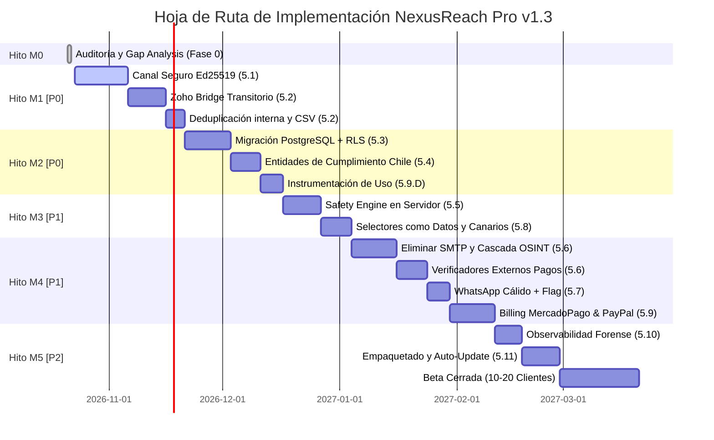

# NexusReach Pro — Auditoría de Código y Análisis de Brechas (Gap Analysis)
> **Documento de la Fase 0 (Sección 0.1 de las Directrices de Ingeniería v1.3)**  
> **Fecha de Auditoría:** 21 de Octubre de 2026  
> **Estado:** Entregable obligatorio previo a la programación en producción

---

## 1. Resumen Ejecutivo de la Auditoría

Se realizó una inspección exhaustiva de todo el repositorio de **NexusReach Pro** (Backend FastAPI, Base de Datos SQLite/PostgreSQL, Runner Desktop en Electron 33 y Frontend React 19) contrastando el código actual contra las especificaciones no negociables de las **Directrices de Ingeniería para Agentes v1.3**.

### Conclusión General
El proyecto cuenta con un grado de avance significativo (~60% de lógica funcional ya construida), destacando:
- Un despachador de tareas funcional y un runner local embebido en Chromium.
- Un motor de secuencias con soporte de árboles y demoras.
- Lógica biométrica antiban avanzada (delays gaussianos, clics fuera del centroide, horarios comerciales).
- Servicios de enriquecimiento y normalización de nombres chilenos.
- Esquema preliminar PostgreSQL con soporte de Row-Level Security (RLS).

Sin embargo, **existen 6 brechas críticas de seguridad y arquitectura que violan prohibiciones explícitas de las directrices v1.3** y deben ser subsanadas de manera prioritaria antes de desplegar o admitir usuarios de pago.

---

## 2. Hallazgos Críticos que Contradicen las Directrices v1.3

| # | Hallazgo Crítico | Ubicación en Código | Regla / Prohibición Violada | Impacto y Acción Requerida |
|---|---|---|---|---|
| **C-01** | **Ejecución de JavaScript Arbitrario en Cliente sin Firma ni Autenticación** | `desktop/main.cjs` (L. 461-484) y `desktop/worker_runner.cjs` | **Sección 5.1 (Requisito 4) y Sección 6 (Regla 2)**: *NUNCA ejecutar código remoto arbitrario en el cliente.* | El endpoint `/evaluate` en el puerto `9099` recibe strings de JS y ejecuta `win.webContents.executeJavaScript()` con `Access-Control-Allow-Origin: *`. Cualquier web o malware local podría secuestrar sesiones de LinkedIn/WhatsApp. **Acción:** Reemplazar por lista cerrada de comandos tipados (`LI_*`, `WA_*`, `ZOHO_*`) firmados con Ed25519. |
| **C-02** | **Sondeo SMTP Propio (`RCPT TO` en Puerto 25)** | `email_resolver_service.py` (L. 284-355: `ping_smtp_mailbox`) | **Sección 5.6 (Requisito 1) y Sección 6 (Regla 14)**: *NUNCA verificar correos por SMTP propio (RCPT TO).* | Utiliza `smtplib.SMTP` saliente en puerto 25 con handshakes `HELO` y `RCPT TO`. Quema la IP del usuario, falla por bloqueos de ISP y arroja falsos positivos en dominios catch-all. **Acción:** Eliminar `ping_smtp_mailbox`; sustituir por cascada OSINT + verificadores externos pagos (`MillionVerifier`, `ZeroBounce`). |
| **C-03** | **Partición de Sesión Única Compartida entre LinkedIn, WhatsApp y Zoho** | `desktop/main.cjs` (L. 45, 114, 165, 228: `WORK_PARTITION_NAME`) | **Sección 5.1 (Requisito 6) y Sección 5.2 (Requisito 2)**: *Particiones de navegador separadas por servicio.* | Las tres plataformas residen en `persist:nexusreach_work_session`. Una sesión podría acceder al almacenamiento o cookies de otra. **Acción:** Separar en particiones independientes (`persist:li_session`, `persist:wa_session`, `persist:zoho_bridge`). |
| **C-04** | **WhatsApp Diseñado para Mensajes en Frío y Sin Feature Flag** | `whatsapp_safety_engine.py` (L. 107, 156) | **Sección 5.7 (Requisito 3) y Sección 6 (Regla 6)**: *NUNCA enviar mensajes de WhatsApp en frío. Solo contactos cálidos.* | La lógica actual contempla "conversaciones frías" y no valida si el lead está conectado (`CONECTADO`) o si hubo interacción previa. Tampoco existe feature flag por tenant. **Acción:** Forzar validación en `task_dispatcher` para rechazar cualquier `WA_SEND_MESSAGE` a leads no cálidos; agregar flag `whatsapp_activo`. |
| **C-05** | **Gobernanza Local de Zoho con Org ID y Selectores Hardcodeados** | `zoho_browser_service.py` (L. 30, 254) y `desktop/main.cjs` (L. 499) | **Sección 5.2 (Requisitos 1, 2, 5)**: *Zoho Bridge gobernado desde la nube con comandos firmados y datos configurables.* | Org ID `org902879914` y queries COQL crudas generadas localmente. Expone registros completos. **Acción:** Reemplazar por 4 comandos de lista cerrada (`ZOHO_FIND_LEAD`, `ZOHO_UPSERT_LEAD`, `ZOHO_SET_STATUS`, `ZOHO_ADD_NOTE`) con Org ID configurable por tenant. |
| **C-06** | **Desalineación del Modelo Comercial y Ausencia de Metering** | `database.py` (Tabla `suscripciones`) | **Sección 1.1, 5.9 y Sección 8.1 (Decisiones 10, 11, 12)**: *15 USD/mes por cuenta de LinkedIn, 500 leads, 100 créditos.* | La base de datos actual conserva un modelo de "puestos de agencia" a 35 USD. Faltan tablas `entitlements`, `usage_counters`, `usage_events` y `credit_ledger`. Tampoco existen pasarelas de pago. **Acción:** Implementar metering por ciclo y conectores para Mercado Pago y PayPal. |

---

## 3. Matriz de Auditoría por Workstream (Secciones 5.1 a 5.11)

| Workstream | Prioridad | Estado | Módulos Relevantes | Riesgos Detectados | Dependencias | Esfuerzo Estimado |
|---|---|:---:|---|---|---|:---:|
| **5.1 Canal de Comandos Seguro** | **P0** | `FALTA` | `desktop/main.cjs`<br>`desktop/worker_runner.cjs`<br>`task_dispatcher.py` | RCE local vía `/evaluate`, falta de verificación Ed25519, sin anti-replay (nonce/TTL), sin allowlist de dominios estricta. | Módulo criptográfico (Ed25519) | **3 semanas (Hito M1)** |
| **5.2 Zoho Bridge Transitorio** | **P0** | `PARCIAL` | `zoho_browser_service.py`<br>`desktop/zoho_preload.cjs`<br>`database.py` | Decisión local en vez de remota, partición compartida, Org ID fijo, sin exportación CSV limpia, exceso de columnas `zoho_*` en `leads`. | Workstream 5.1 | **2 semanas (Hito M1)** |
| **5.3 Multi-tenancy, Auth y PostgreSQL** | **P0** | `PARCIAL` | `database.py`<br>`schema_postgres.sql`<br>`auth_service.py` | En desarrollo se sigue usando SQLite local. Faltan tablas: `devices`, `linkedin_accounts`, `lead_activity`, `email_candidates`, `commands`. | PostgreSQL São Paulo (`sa-east-1`) | **3 semanas (Hito M2)** |
| **5.4 Datos Personales y Cumplimiento (Chile)** | **P0** | `FALTA` | `database.py`<br>`main.py`<br>`email_resolver_service.py` | Sin registro de base de licitud (`legal_basis`), sin lista de supresión formal (`suppression_list`), sin purga a 12 meses ni borrado de tenant en ≤ 30 días. | Workstream 5.3 | **2 semanas (Hito M2)** |
| **5.5 Antiban y Huella Digital** | **P1** | `PARCIAL` | `safety_engine.py`<br>`desktop/worker_runner.cjs` | Límites guardados en configuración global plana (no por cuenta de LinkedIn). Falta variación estocástica por usuario y freeze automático ante checkpoint. | Workstream 5.1, 5.3 | **2 semanas (Hito M3)** |
| **5.6 Resolver de Correos (OSINT + Externos)** | **P1** | `PARCIAL` | `email_resolver_service.py`<br>`database.py` | **Presencia de `RCPT TO` (SMTP directo)**. Falta interfaz `EmailVerifier`, integración con `MillionVerifier`/`ZeroBounce`/`Serper` y registro de costo real en USD. | Cuentas API de MillionVerifier y Serper | **3 semanas (Hito M4)** |
| **5.7 WhatsApp (Solo Contactos Cálidos)** | **P1** | `PARCIAL` | `whatsapp_safety_engine.py`<br>`task_dispatcher.py` | No valida si el contacto es cálido (permite envíos fríos). Falta feature flag por tenant y verificación previa `WA_CHECK_NUMBER`. | Workstream 5.1, 5.4 | **1.5 semanas (Hito M4)** |
| **5.8 Resiliencia ante Cambios de Interfaz** | **P1** | `FALTA` | `desktop/worker_runner.cjs`<br>`zoho_browser_service.py` | Selectores DOM hardcodeados en scripts. No hay canarios automatizados ni distribución de selectores versionados y firmados como datos. | Workstream 5.1 | **2 semanas (Hito M3)** |
| **5.9 Facturación, Límites Comerciales y Metering** | **P1** | `FALTA` | `database.py`<br>`main.py`<br>Nuevo `billing_service.py` | No existe metering de 500 leads / 100 créditos, ni ledger de costos, ni integración de webhooks con Mercado Pago y PayPal. | Credenciales Mercado Pago & PayPal | **3 semanas (Hito M4)** |
| **5.10 Observabilidad y Soporte** | **P2** | `PARCIAL` | `logger_service.py`<br>`system_logs`<br>`AutopilotBanner.jsx` | Logs no correlacionados por `command_id`. Potencial exposición de PII en logs. Falta herramienta de diagnóstico descargable sin secretos. | Workstream 5.1 | **1 semana (Hito M5)** |
| **5.11 Distribución, Firma y Auto-actualización** | **P2** | `FALTA` | `desktop/package.json`<br>`desktop/main.cjs` | No hay empaquetado con `electron-builder`, ni firma de código (.exe / .dmg), ni verificación de versión mínima de cliente. | Certificado Code Signing (Windows/Apple) | **2 semanas (Hito M5)** |

---

## 4. Análisis Detallado por Workstream

### 4.1. Workstream 5.1: Canal de Comandos Seguro (Backend → Cliente)
* **Objetivo:** Garantizar que el cliente local solo ejecute acciones autorizadas, inmutables y firmadas criptográficamente, neutralizando el riesgo de que un backend comprometido tome control de las cuentas del usuario.
* **Estado Actual:** `FALTA`
  - La comunicación actual se basa en HTTP sin autenticar entre Electron (`localhost:9099`) y FastAPI (`localhost:8000`).
  - El endpoint `/evaluate` en Electron ejecuta JavaScript libre mediante `win.webContents.executeJavaScript(executable)`.
  - No hay validación de dominios de navegación: `/navigate` permite cualquier URL.
  - No existe modelo de datos de dispositivos (`devices`).
* **Brechas Específicas frente a v1.3:**
  1. Falta generación y registro de claves de dispositivo Ed25519 en el primer arranque del cliente.
  2. Falta servicio de firma de comandos (Mock KMS/Local KMS para desarrollo; KMS real en São Paulo para producción).
  3. Falta validación anti-replay (`command_id`, `nonce`, timestamp `issued_at`, TTL `expires_at` ≤ 120 s).
  4. Falta lista cerrada de acciones tipadas:
     ```
     LI_VISIT_PROFILE | LI_SEND_INVITE | LI_SEND_MESSAGE | LI_SYNC_CONNECTIONS | 
     LI_READ_CONTACT_INFO | WA_SEND_MESSAGE | WA_CHECK_NUMBER | 
     ZOHO_FIND_LEAD | ZOHO_UPSERT_LEAD | ZOHO_SET_STATUS | ZOHO_ADD_NOTE | PAUSE | RESUME
     ```
  5. Falta allowlist estricta de dominios en Electron (`*.linkedin.com`, `web.whatsapp.com`, `*.zoho.com`).
  6. Falta reporte firmado de resultados del cliente hacia el backend.

---

### 4.2. Workstream 5.2: Zoho Bridge Transitorio y Funciones Internas
* **Objetivo:** Mantener la operatividad actual con Zoho CRM mediante automatización de interfaz como puente temporal, pero desacoplándolo de la lógica central y sometiéndolo a comandos firmados.
* **Estado Actual:** `PARCIAL`
  - `zoho_browser_service.py` funciona como un cliente inteligente local: genera consultas COQL complejas e interactúa directamente con la ventana del navegador.
  - La base de datos tiene más de 12 columnas exclusivas de Zoho incrustadas en `leads` (`zoho_id`, `zoho_lead_status`, `zoho_cuenta_id`, etc.).
* **Brechas Específicas frente a v1.3:**
  1. La decisión de negocio reside en el cliente en lugar del servidor.
  2. No utiliza los 4 comandos firmados de lista cerrada (`ZOHO_FIND_LEAD`, `ZOHO_UPSERT_LEAD`, `ZOHO_SET_STATUS`, `ZOHO_ADD_NOTE`).
  3. `ZOHO_FIND_LEAD` debe retornar únicamente los campos indispensables (`found`, `id`, `owner`, `status`), no el objeto completo.
  4. Partición de sesión no aislada: comparte cookies con LinkedIn y WhatsApp.
  5. No existe feature flag por tenant para activar/desactivar Zoho Bridge.
  6. Falta la función interna de **Exportación CSV** formal de leads con estados y bitácora de actividades, reduciendo la dependencia de Zoho.

---

### 4.3. Workstream 5.3: Multi-tenancy, Autenticación y PostgreSQL
* **Objetivo:** Migrar la persistencia a PostgreSQL con aislamiento estricto mediante Row-Level Security (RLS) y soporte multi-tenant real.
* **Estado Actual:** `PARCIAL`
  - Existe un archivo de diseño avanzado `schema_postgres.sql` con políticas RLS para las tablas principales.
  - `database.py` contiene un conector dual condicional (`IS_POSTGRES`).
  - Sin embargo, la aplicación en ejecución activa sigue trabajando contra SQLite local (`leads.db`).
* **Brechas Específicas frente a v1.3:**
  1. No están creadas las tablas clave requeridas:
     - `devices`
     - `linkedin_accounts` (unidad facturable)
     - `whatsapp_accounts`
     - `lead_contacts`
     - `lead_activity`
     - `email_candidates`
     - `commands` y `command_results`
     - `suppression_list` y `consent_records`
     - `entitlements`, `usage_counters`, `usage_events`, `credit_ledger`
  2. Faltan en la tabla `leads` las columnas de cumplimiento: `source`, `source_url`, `collected_at`, `legal_basis`.
  3. El modelo de `suscripciones` actual está basado en "puestos", no en cuentas de LinkedIn conectadas.
  4. Falta cifrado a nivel de campo (Field-Level Encryption) para correos y teléfonos.

---

### 4.4. Workstream 5.4: Datos Personales y Cumplimiento (Chile — Ley 21.719)
* **Objetivo:** Adecuar el tratamiento de datos a la normativa chilena de protección de datos personales y estándares de minimización.
* **Estado Actual:** `FALTA`
  - Actualmente los datos se capturan y almacenan sin registrar su base de licitud ni origen explícito.
* **Brechas Específicas frente a v1.3:**
  1. Falta trazabilidad por lead de: `source`, `source_url`, `collected_at`, `legal_basis`.
  2. Falta tabla `suppression_list` con búsqueda optimizada por hash SHA-256 (para verificar exclusión de forma inmediata antes de cada acción).
  3. No hay mecanismo para generar enlaces de baja (unsubscribe) en correos salientes.
  4. No existe proceso cron de purga automática para leads inactivos tras 12 meses.
  5. No existe endpoint de borrado total de tenant (hard-delete en ≤ 30 días tras cancelación).
  6. No existen endpoints de ejercicio de derechos ARCO (exportación y supresión de lead individual).

---

### 4.5. Workstream 5.5: Antiban y Huella Digital
* **Objetivo:** Asegurar que los límites y el comportamiento del runner reproduzcan de manera indistinguible la actividad humana, gobernados enteramente por el servidor.
* **Estado Actual:** `PARCIAL`
  - `safety_engine.py` cuenta con excelente base: pausas gaussianas (180–360s), clics fuera del centroide geométrico y rampa de calentamiento progresivo (calibrada a 15/día).
* **Brechas Específicas frente a v1.3:**
  1. Los límites se guardan en una tabla global plana (`configuracion_seguridad`). Deben ser por cuenta conectada (`linkedin_accounts`).
  2. Falta variabilidad por cuenta: semillas de aleatoriedad, jitter en horarios de inicio/fin y perfiles de scroll diferenciados para no compartir un patrón idéntico entre usuarios.
  3. Detección automática en el runner de checkpoints, CAPTCHAs o advertencias de LinkedIn para congelar inmediatamente la cola de esa cuenta.
  4. Kill-switch global si la tasa de incidentes se dispara anómalamente en la plataforma.
  5. Separación absoluta entre límites de seguridad y límites comerciales.

---

### 4.6. Workstream 5.6: Resolver de Correos (OSINT Propio + Verificadores Externos)
* **Objetivo:** Establecer una cascada de enriquecimiento eficiente, priorizando fuentes públicas gratuitas y eliminando prácticas que dañen la reputación de red.
* **Estado Actual:** `PARCIAL` (con riesgo crítico)
  - `email_resolver_service.py` cuenta con algoritmos avanzados de parsing de nombres chilenos y síntesis de patrones corporativos.
  - **Infracción Grave:** Utiliza `ping_smtp_mailbox` para conectar vía socket al puerto 25 y ejecutar `RCPT TO`.
* **Brechas Específicas frente a v1.3:**
  1. **Obligatorio:** Eliminar completamente la verificación SMTP propia (`ping_smtp_mailbox`).
  2. Diseñar la cascada en estricto orden de costos:
     - Fuentes públicas institucionales (sitios web de colegios, PDFs, `mailto`).
     - Datos de 1.er grado de LinkedIn (overlay de contacto).
     - Inferencia de patrones por dominio.
     - Chequeos gratuitos (sintaxis, DNS MX, desechables).
     - Verificación externa pagada (tope máx. 3 intentos por lead).
  3. Crear la interfaz abstracta `EmailVerifier` con implementaciones para `MillionVerifier` (principal) y `ZeroBounce` (alternativo), más `Serper` para búsqueda web.
  4. Estados de resultado estructurados: `valid`, `invalid`, `catch_all`, `risky`, `unknown` con puntaje de confianza.
  5. Registro de costo real en USD en `usage_events` y consumo en `credit_ledger`.
  6. Envío de correos mediante APIs oficiales con OAuth (Gmail / Microsoft Graph), nunca SMTP propio.

---

### 4.7. Workstream 5.7: WhatsApp (Solo Contactos Cálidos)
* **Objetivo:** Automatizar mensajes de seguimiento en WhatsApp Web mitigando al máximo el riesgo de bloqueo de línea.
* **Estado Actual:** `PARCIAL`
  - `whatsapp_safety_engine.py` tiene normalización E.164 (+56), sanitización de enlaces en primer mensaje y simulación de tipeo biométrico.
* **Brechas Específicas frente a v1.3:**
  1. **Infracción de directriz:** El código actual hace referencia a "conversaciones frías". Las directrices v1.3 prohíben taxativamente el envío en frío.
  2. El despachador debe validar obligatoriamente que el lead sea un contacto cálido (`estado == 'CONECTADO'` o con interacción previa confirmada) antes de emitir `WA_SEND_MESSAGE`.
  3. Incorporar feature flag por tenant (`whatsapp_activo`), desactivado por defecto.
  4. Verificación previa de existencia de cuenta (`WA_CHECK_NUMBER`) con caché por tenant.

---

### 4.8. Workstream 5.8: Resiliencia ante Cambios de Interfaz
* **Objetivo:** Desacoplar los selectores DOM del código fuente para que las actualizaciones de LinkedIn, WhatsApp o Zoho no requieran compilar y redistribuir el software.
* **Estado Actual:** `FALTA`
  - Todos los selectores están codificados en duro dentro de strings en Python y JavaScript.
* **Brechas Específicas frente a v1.3:**
  1. Abstracción donde los selectores sean datos versionados y firmados.
  2. Implementación de estrategias de respaldo (atributos de accesibilidad `aria-label`, estructura DOM, texto relativo).
  3. Pruebas de contrato y canarios periódicos contra cuentas de prueba.
  4. Mecanismo de degradación segura: si una acción falla repetidamente, pausar esa acción específica sin reintentos infinitos.

---

### 4.9. Workstream 5.9: Facturación, Límites Comerciales y Metering
* **Objetivo:** Instrumentar el modelo de negocio decidido (15 USD/mes por cuenta de LinkedIn, 500 leads, 100 créditos) con cobro automatizado en Mercado Pago y PayPal.
* **Estado Actual:** `FALTA`
  - No existe sistema de créditos ni conteo de leads activados por ciclo.
  - La tabla `suscripciones` contiene campos del modelo antiguo de agencia.
* **Brechas Específicas frente a v1.3:**
  1. Tablas requeridas: `entitlements`, `usage_counters`, `usage_events`, `credit_ledger`.
  2. Lógica de cuotas comerciales por ciclo de facturación:
     - 500 leads activados (primer contacto en cualquier canal). Al agotarse, se rechazan nuevas activaciones con `LIMIT_LEADS_REACHED`, pero las secuencias en curso continúan intactas.
     - 100 créditos de correo. Se consumen solo por resultado utilizable (`valid`, o `catch_all` confiable). Al agotarse: `LIMIT_CREDITS_REACHED`.
  3. Compra de packs adicionales:
     - Leads: +500 por 5 USD (solo ciclo actual).
     - Créditos: 100 por 6 USD y 500 por 28 USD (sin caducidad).
  4. Interfaz `PaymentProvider` con implementaciones para:
     - **Mercado Pago** (clientes de Chile).
     - **PayPal** (resto del mundo).
  5. Manejo idempotente de webhooks de pago y sincronización de suscripciones (`trialing`, `active`, `past_due`, `canceled`).

---

### 4.10. Workstream 5.10: Observabilidad y Soporte
* **Objetivo:** Disponer de telemetría forense para diagnóstico ágil y métricas operativas sin invadir la privacidad del usuario.
* **Estado Actual:** `PARCIAL`
  - `logger_service.py` registra eventos en `system_logs`.
  - Frontend cuenta con `AutopilotBanner` interactivo y consola de logs.
* **Brechas Específicas frente a v1.3:**
  1. Falta correlación obligatoria de trazas mediante `command_id`.
  2. Auditoría y depuración de logs para asegurar la ausencia total de datos personales (PII), contraseñas o tokens.
  3. Métricas agregadas por cuenta: tasa de aceptación, incidentes de seguridad, latencia de comandos.
  4. Función de exportación de diagnóstico empaquetado para soporte técnico.

---

### 4.11. Workstream 5.11: Distribución, Firma y Auto-actualización
* **Objetivo:** Empaquetar y distribuir el cliente local de forma segura, reduciendo fricción de instalación y falsos positivos de antivirus.
* **Estado Actual:** `FALTA`
  - Solo se ejecuta en modo desarrollador con Node.js local.
* **Brechas Específicas frente a v1.3:**
  1. Configuración de `electron-builder` para generar instaladores firmados (.exe en Windows con EV Code Signing; .dmg en macOS con notarización de Apple).
  2. Módulo de auto-actualización (`electron-updater`) con verificación de firma y política de versión mínima del cliente.
  3. Rotación de claves públicas de verificación integradas en el cliente.

---

## 5. Comparativa de Modelos de Base de Datos



---

## 6. Plan de Mitigación por Hitos (M0 a M5)

De acuerdo con el orden mandatado en la Sección 7 de las Directrices v1.3, el plan de trabajo se estructurará estrictamente de la siguiente manera:



---

## 7. Próximos Pasos Inmediatos para el Agente

1. **Entrega de la Fase 0:** Presentar este informe formal `docs/audit_gap_analysis.md` al responsable humano.
2. **Inicio del Hito M1 (Workstream 5.1 & 5.2):**
   - Construir la infraestructura de firma de comandos Ed25519 y verificación anti-replay.
   - Refactorizar `desktop/worker_runner.cjs` y `desktop/main.cjs` para eliminar `/evaluate` y admitir únicamente la enumeración cerrada de acciones tipadas.
   - Aislar las particiones de sesión en Chromium (`persist:li_session`, `persist:wa_session`, `persist:zoho_bridge`).
   - Transformar `zoho_browser_service.py` en el cliente del Zoho Bridge transitorio gobernado desde la nube vía comandos `ZOHO_*`.

---
*Documento generado conforme a la directriz operativa de NexusReach Pro v1.3. Aprobación requerida antes de escribir código del Hito M1.*
