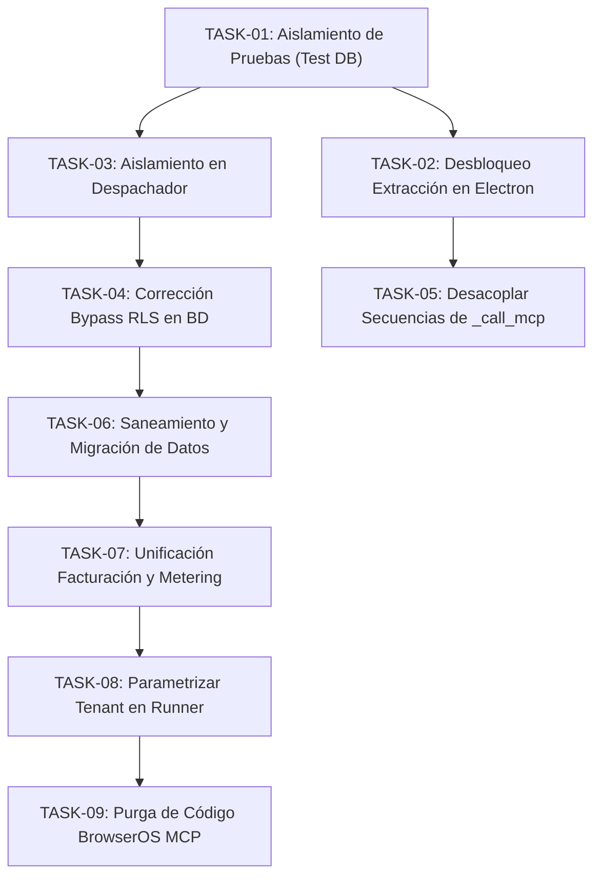

# NexusReach Pro — Backlog de Estabilización y Saneamiento (Fase 2)

> **Documento Operativo de Tareas de Ingeniería, Criterios de Aceptación y Priorización**  
> **Alcance:** Exclusivo a las directrices de la auditoría técnica aprobada y decisiones de producto confirmadas (Electron como cliente único, foco en LinkedIn + Facturación, y saneamiento quirúrgico de base de datos).  
> **Estado:** Aprobado para Ejecución Incremental  
> **Fecha:** Octubre 2026

---

## 1. Diagrama de Flujo y Dependencias del Backlog

---

## 2. Problemas Confirmados (Backlog Principal Priorizado)

### SPRINT 1: Infraestructura de Verificación y Desbloqueo Crítico de LinkedIn

#### `TASK-01` — Aislamiento estricto de la suite de pruebas frente a la base de datos de trabajo
- **Problema y evidencia:** Las pruebas automáticas de backend insertan datos directamente sobre `leads.db` en sus métodos `setUp()`. Ver evidencia en `tests/test_signed_commands.py:53-59` y `tests/test_data_privacy_compliance.py:46-52`, lo que ha poblado la base real con más de 30 tenants residuales de prueba.
- **Comportamiento actual:** Cada corrida de pruebas contamina la base de datos operativa y falsea conteos reales.
- **Resultado esperado:** Las pruebas se ejecutan contra una base de datos SQLite aislada en memoria (`:memory:`) o un archivo transitorio que se crea y destruye al finalizar, dejando intacta `leads.db`.
- **Módulos afectados:** `database.py`, suites dentro de `tests/`.
- **Dependencias:** Ninguna (tarea habilitadora inicial).
- **Criterios de aceptación:**
  1. Ejecutar las suites de prueba no altera el tamaño, hash ni registros de `leads.db`.
  2. Las pruebas son reproducibles e independientes del estado previo de la base de datos.
- **Pruebas necesarias:** Verificación de hash/conteo de `leads.db` antes y después de correr la suite unitaria.
- **Riesgo de regresión:** Nulo.
- **Complejidad estimada:** Baja.
- **Tipo:** Prueba / Saneamiento.
- **Condiciones que impedirían cerrar la tarea:** Que alguna prueba falle por requerir esquemas persistidos fuera de su propio ciclo de vida.

---

#### `TASK-02` — Desbloqueo de búsqueda y extracción de prospectos en Electron
- **Problema y evidencia:** La búsqueda de perfiles en LinkedIn está 100% rota en la aplicación de escritorio. `extractor_engine.py:379` invoca `browser_service._call_mcp_evaluate(EXTRACTION_SCRIPT_JS)`, pero `browser_service.py:439-444` retorna error 403 `ACCESO_DENEGADO (C-01)` cuando Electron está en ejecución, provocando que la búsqueda siempre retorne 0 prospectos.
- **Comportamiento actual:** La extracción en Electron falla silenciosamente y no captura ningún lead.
- **Resultado esperado:** La extracción se ejecuta mediante una función precompilada localmente en Electron (expuesta a través de un endpoint seguro `/search/extract` en `desktop/main.cjs`), de forma análoga a la extracción de contactos de 1er grado ya verificada.
- **Módulos afectados:** `extractor_engine.py`, `browser_service.py`, `desktop/main.cjs`, `desktop/security/action_handlers.cjs`.
- **Dependencias:** `TASK-01`.
- **Criterios de aceptación:**
  1. La función `search_and_extract` en `extractor_engine.py` no realiza llamadas a `_call_mcp_evaluate`.
  2. Una búsqueda en LinkedIn sobre una página de resultados extrae correctamente los leads y sus metadatos (nombre, cargo, empresa, URL).
  3. No se vulnera la prohibición C-01: cero strings dinámicos de JavaScript transferidos sobre HTTP.
- **Pruebas necesarias:** Prueba de extracción sobre DOM fixture o página de búsqueda simulada en Electron sin errores 403.
- **Riesgo de regresión:** Medio (toca el parser de DOM de resultados de búsqueda).
- **Complejidad estimada:** Media.
- **Tipo:** Corrección.
- **Condiciones que impedirían cerrar la tarea:** Que los selectores de búsqueda de LinkedIn requieran actualización por cambios recientes en la interfaz.

---

#### `TASK-03` — Aislamiento estricto multi-tenant en el Despachador de Tareas
- **Problema y evidencia:** `task_dispatcher.py:98-105` adivina el tenant leyendo el último login en `audit_logs` (`SELECT tenant_id FROM audit_logs WHERE accion = 'LOGIN_EXITOSO' ORDER BY timestamp DESC LIMIT 1`). Adicionalmente, `task_dispatcher.py:162-189` aplica una consulta fallback que despacha tareas globales sin filtrar por `tenant_id`.
- **Comportamiento actual:** Un cliente o runner puede ejecutar tareas y consumir prospectos de otro cliente si no se envía el tenant explícito.
- **Resultado esperado:** El despachador exige un `tenant_id` válido y validado contra el dispositivo emparejado. Si no hay prospectos para ese tenant específico, responde cola vacía y nunca busca en otros tenants.
- **Módulos afectados:** `task_dispatcher.py`, `main.py`.
- **Dependencias:** `TASK-01`.
- **Criterios de aceptación:**
  1. Se eliminan las consultas de inferencia sobre `audit_logs` y el fallback global sin tenant.
  2. La petición a `/api/worker/proxima-tarea` rechaza la solicitud si el `device_id` no está emparejado con el `tenant_id` declarado.
  3. Prueba automatizada demuestra que el Tenant A jamás recibe tareas del Tenant B.
- **Pruebas necesarias:** Test unitario en `tests/test_hybrid_dispatcher.py` con dos tenants activos y colas independientes.
- **Riesgo de regresión:** Bajo.
- **Complejidad estimada:** Baja.
- **Tipo:** Corrección / Seguridad.
- **Condiciones que impedirían cerrar la tarea:** Que el runner local no envíe el `tenant_id` en sus llamadas actuales (se cubre en `TASK-08`).

---

#### `TASK-04` — Corrección del bypass de Row-Level Security en PostgreSQL
- **Problema y evidencia:** En `database.py:136-137` y `database.py:159-160`, la cláusula `else` ejecuta `SET LOCAL app.is_super_admin = 'true';` cuando no se provee `tenant_id`.
- **Comportamiento actual:** Cualquier consulta que olvide pasar `tenant_id` adquiere privilegios totales de superusuario en PostgreSQL, evadiendo las políticas RLS de `schema_postgres.sql`.
- **Resultado esperado:** Si no se especifica `tenant_id` y `is_super_admin` es `False`, la sesión debe fijarse explícitamente en modo restringido (`app.is_super_admin = 'false'` y `app.current_tenant_id = '00000000-0000-0000-0000-000000000000'`), devolviendo 0 filas por diseño.
- **Módulos afectados:** `database.py`.
- **Dependencias:** Ninguna.
- **Criterios de aceptación:**
  1. Solo cuando `is_super_admin=True` es pasado de manera intencional se elevan privilegios.
  2. Una consulta sin tenant sobre PostgreSQL con RLS activado no expone datos de ningún tenant.
- **Pruebas necesarias:** Test de regresión en `tests/test_multitenant_init.py`.
- **Riesgo de regresión:** Muy bajo (en SQLite es inocuo, en PostgreSQL previene brechas críticas).
- **Complejidad estimada:** Baja.
- **Tipo:** Corrección / Seguridad.
- **Condiciones que impedirían cerrar la tarea:** Ninguna.

---

#### `TASK-05` — Desacoplamiento de ejecución de secuencias y eliminación de `_call_mcp_evaluate`
- **Problema y evidencia:** `sequence_engine.py:771, 870, 893, 948, 1089` intenta ejecutar acciones directas en el navegador usando scripts inyectados por `_call_mcp_evaluate`.
- **Comportamiento actual:** La función interactiva `execute_sequence_next_step` falla en Electron por la directriz C-01.
- **Resultado esperado:** Toda ejecución física de pasos de secuencia se delega exclusivamente al despachador de tareas (`task_dispatcher`) para su emisión como comando firmado Ed25519 hacia Electron. `sequence_engine.py` solo gestiona el cálculo de estados y fechas.
- **Módulos afectados:** `sequence_engine.py`, `main.py`.
- **Dependencias:** `TASK-02`, `TASK-03`.
- **Criterios de aceptación:**
  1. Se eliminan todas las llamadas a `_call_mcp_evaluate` en `sequence_engine.py`.
  2. Los pasos de visita, invitación y mensaje avanzan de estado únicamente tras recibir el reporte firmado del runner en `/api/worker/reportar-resultado`.
- **Pruebas necesarias:** Suite en `tests/test_hito4_multichannel_antiban.py`.
- **Riesgo de regresión:** Medio.
- **Complejidad estimada:** Media.
- **Tipo:** Refactorización / Corrección.
- **Condiciones que impedirían cerrar la tarea:** Que el despachador no soporte alguno de los tipos de pasos configurados en la UI.

---

### SPRINT 2: Saneamiento de Persistencia y Modelo Comercial

#### `TASK-06` — Saneamiento quirúrgico de base de datos y migración al modelo $15/mes
- **Problema y evidencia:** `leads.db` contiene 194 leads válidos mezclados con más de 30 tenants residuales de pruebas automáticas. La tabla `subscriptions` tiene 0 filas mientras `suscripciones` mantiene el modelo legacy de puestos de 35 USD.
- **Comportamiento actual:** El backend lee tablas divergentes; `auth_service.py` lee `suscripciones` y `entitlements_service.py` lee `subscriptions`.
- **Resultado esperado:** Script idempotente que:
  1. Genere respaldo `leads.db.bak`.
  2. Elimine los tenants de prueba espurios (`ten_*_test`, `ten_wa_*`, `ten_cli_*`) y sus dependencias huérfanas.
  3. Conserve los tenants legítimos (`ten_superadmin`, cuentas de Gabriel Vera) y sus 194 leads.
  4. Siembre en `subscriptions` y `entitlements` los registros del modelo oficial de 15 USD/mes (500 leads, 100 créditos) con abono inicial en `credit_ledger`.
- **Módulos afectados:** `database.py`, nuevo script de migración en `scripts/sanitize_and_migrate_db.py`.
- **Dependencias:** `TASK-01`.
- **Criterios de aceptación:**
  1. El conteo de leads legítimos se preserva intacto (194 leads).
  2. Se eliminan los tenants basura de pruebas.
  3. Los tenants conservados tienen suscripción activa en `subscriptions` y 100 créditos en `credit_ledger`.
  4. Existe copia de respaldo verificable antes de la ejecución.
- **Pruebas necesarias:** Verificación de integridad relacional SQLite (`PRAGMA foreign_key_check`) y conteo de filas.
- **Riesgo de regresión:** Bajo (protegido por respaldo previo).
- **Complejidad estimada:** Baja.
- **Tipo:** Saneamiento.
- **Condiciones que impedirían cerrar la tarea:** Que existan leads legítimos vinculados a IDs de tenants de test que requieran reasignación previa.

---

#### `TASK-07` — Unificación de Facturación, Metering y Desconexión de "Puestos de Agencia"
- **Problema y evidencia:** `auth_service.py:75-96` y varios endpoints en `main.py` validan acceso contra `suscripciones.puestos_contratados` a 35 USD, ignorando `entitlements_service.py` y `subscriptions`.
- **Comportamiento actual:** La validación de login y permisos opera bajo una lógica comercial derogada.
- **Resultado esperado:** `auth_service.py` valida la vigencia de la cuenta contra `subscriptions` y `entitlements` (unidad de cobro = cuenta conectada; cuota de 500 leads por ciclo). Los endpoints obsoletos de asignación de puestos (`/api/tenants/{tenant_id}/puestos`, etc.) quedan deshabilitados o retornan deprecación.
- **Módulos afectados:** `auth_service.py`, `main.py`, `entitlements_service.py`.
- **Dependencias:** `TASK-06`.
- **Criterios de aceptación:**
  1. Ninguna consulta en `auth_service.py` depende de la tabla legacy `suscripciones`.
  2. Los usuarios con suscripción activa en `subscriptions` inician sesión correctamente.
  3. Los límites de 500 prospectos y 100 créditos se aplican en el ciclo de facturación.
- **Pruebas necesarias:** Suite completa en `tests/test_entitlements_and_billing.py` y `tests/test_multitenancy_and_auth.py`.
- **Riesgo de regresión:** Medio (toca el flujo de autenticación).
- **Complejidad estimada:** Media.
- **Tipo:** Refactorización / Corrección.
- **Condiciones que impedirían cerrar la tarea:** Que la UI intente invocar endpoints de puestos eliminados.

---

#### `TASK-08` — Parametrización dinámica del dispositivo en el Runner Desktop
- **Problema y evidencia:** `desktop/worker_runner.cjs:82` registra el runner con valor estático `tenant_id: 'ten_superadmin'`.
- **Comportamiento actual:** Todo cliente que ejecuta la aplicación de escritorio se empareja de manera forzada con el tenant del superadministrador.
- **Resultado esperado:** El runner local lee el `tenant_id` y token del usuario desde la sesión activa iniciada en la interfaz de Electron, emparejando el dispositivo con el tenant que efectivamente inició sesión.
- **Módulos afectados:** `desktop/worker_runner.cjs`, `desktop/main.cjs`.
- **Dependencias:** `TASK-03`, `TASK-07`.
- **Criterios de aceptación:**
  1. `worker_runner.cjs` no contiene `tenant_id: 'ten_superadmin'` hardcodeado.
  2. Las tareas solicitadas en `/api/worker/proxima-tarea` corresponden al tenant autenticado en la ventana principal.
- **Pruebas necesarias:** Prueba de registro de dispositivo y despacho en `desktop/tests/test_security_subsystem.cjs`.
- **Riesgo de regresión:** Bajo.
- **Complejidad estimada:** Baja.
- **Tipo:** Corrección.
- **Condiciones que impedirían cerrar la tarea:** Falta de canal IPC entre la ventana de autenticación y el runner en segundo plano de Electron.

---

### SPRINT 3: Simplificación y Depuración de Código Muerto

#### `TASK-09` — Purga de dependencias y código obsoleto de BrowserOS MCP
- **Problema y evidencia:** Tras confirmarse que Electron es el único cliente oficial, permanecen en el repositorio constantes, endpoints y funciones de BrowserOS MCP (puerto `9010`, `MCP_URL`, `_mcp_open_session`, `_mcp_tool_text` y `_call_mcp_evaluate` en `browser_service.py:434-467` y `extractor_engine.py:18, 155`).
- **Comportamiento actual:** Código muerto confuso que induce a errores en agentes y desarrolladores.
- **Resultado esperado:** Eliminación limpia de las funciones y variables de BrowserOS MCP. `browser_service.py` queda 100% dedicado a la comunicación con Electron en el puerto `9099`.
- **Módulos afectados:** `browser_service.py`, `extractor_engine.py`, `tests/test_browser_service_electron.py`.
- **Dependencias:** `TASK-02`, `TASK-05`.
- **Criterios de aceptación:**
  1. No quedan referencias a `9010` ni `_call_mcp_evaluate` en todo el repositorio Python.
  2. La suite `test_browser_service_electron.py` se actualiza para verificar únicamente el runner de Electron.
- **Pruebas necesarias:** Búsqueda textual global en el proyecto confirmando 0 ocurrencias de variables MCP y ejecución de pruebas de navegador.
- **Riesgo de regresión:** Muy bajo (código ya inutilizado).
- **Complejidad estimada:** Baja.
- **Tipo:** Eliminación / Simplificación.
- **Condiciones que impedirían cerrar la tarea:** Ninguna.

---

## 3. Hipótesis que Necesitan Investigación

- **`HIP-01` — Virtualización del DOM en Búsquedas de LinkedIn (SDUI 2026):**
  - *Hipótesis:* El scroll progresivo en la página de búsqueda de LinkedIn podría descartar del DOM las tarjetas superiores al avanzar hacia abajo (virtualización de listas), afectando la cantidad de leads recolectados por página.
  - *Evidencia a recolectar:* Observar el comportamiento del DOM en una sesión de Electron con 10 resultados para certificar si los nodos permanecen o se reemplazan.
- **`HIP-02` — Persistencia del Runner ante Suspensión del Sistema:**
  - *Hipótesis:* Cuando el sistema operativo Windows entra en suspensión o ahorro de energía, el bucle `loopTimeout` de `worker_runner.cjs` puede desincronizarse o acumular llamadas de heartbeat desfasadas.
  - *Evidencia a recolectar:* Registrar telemetría de pausas prolongadas en `observability_service.py` y medir reconexión al reanudar.
- **`HIP-03` — Tasa de Falsos Positivos de Catch-All en Dominios Educacionales Chilenos:**
  - *Hipótesis:* Los servidores de correo institucionales (`.cl`, colegios, universidades) tienden a configurar políticas *catch-all* o rechazar consultas directas sin autenticar, lo que podría aumentar la proporción de estados `unknown` en la cascada de resolución.
  - *Evidencia a recolectar:* Ejecutar prueba controlada de la cascada sobre 20 dominios de colegios extraídos de `leads.db`.

---

## 4. Mejoras Opcionales (Fuera del Alcance Inmediato)

- **`OPT-01` — Modularización de `main.py` mediante FastAPI `APIRouter`:**
  - *Descripción:* Dividir las 2.217 líneas de `main.py` en submódulos ordenados (`routers/auth.py`, `routers/leads.py`, `routers/sequences.py`, `routers/billing.py`).
  - *Motivo de postergación:* Es una mejora de mantenimiento que no aporta funcionalidad directa al usuario y conlleva riesgo de alterar rutas si no se hace con cuidado.
- **`OPT-02` — Framework de pruebas unitarias en Frontend (Vitest):**
  - *Descripción:* Incorporar Vitest y React Testing Library en `frontend/`.
  - *Motivo de postergación:* La prioridad aprobada es estabilizar el motor de LinkedIn y la facturación en backend y runner.
- **`OPT-03` — Firma de binarios y auto-actualización con `electron-builder`:**
  - *Descripción:* Configurar certificados de code signing de Windows para el instalador `.exe`.
  - *Motivo de postergación:* Pertenece al Hito M5 (Fase de distribución y beta cerrada).

---

## 5. Decisiones de Producto que Requieren Aprobación

1. **`DEC-01` — Ocultamiento de vistas de "Puestos de Agencia" en la UI:**  
   En la interfaz actual de React existen botones y vistas para "Puestos de Agencia", "Admin Clientes" y "Finanzas". Dado que el modelo oficial es de 15 USD/cuenta sin puestos:  
   *¿Apruebas que en el frontend ocultemos temporalmente estas pestañas del menú lateral para evitar confusiones operativas en la beta?*
2. **`DEC-02` — Política de reactivación de prospectos duplicados entre secuencias:**  
   Si un prospecto ya fue contactado en la Secuencia A dentro del mismo tenant y el usuario intenta agregarlo a la Secuencia B:  
   *¿Debe el sistema bloquear la nueva activación por deduplicación interna o permitir enrolarlo si la secuencia anterior ya finalizó hace más de 90 días?*

---

## 6. Primera Tarea Seleccionada para Iniciar

### 🎯 Tarea de Inicio: `TASK-01` — Aislamiento estricto de la suite de pruebas frente a `leads.db`

- **Por qué es la mejor opción para arrancar:**
  1. **Riesgo Cero de Regresión Funcional:** No modifica la lógica de prospección ni altera la interfaz de usuario.
  2. **Protección Inmediata del Entorno:** Evita que cualquier corrida de pruebas posterior vuelva a ensuciar la base de datos de trabajo o corrompa los 194 leads existentes.
  3. **Habilitadora de Confianza:** Proporciona un arnés de pruebas limpio y seguro para validar de forma determinista todas las tareas siguientes (`TASK-02`, `TASK-03`, `TASK-04`).
