# NexusReach Pro — Informe de Auditoría Técnica Integral (Fase 1)

> **Documento de Auditoría de Arquitectura, Estado Real y Brechas del Sistema**  
> **Fecha de Auditoría:** Octubre 2026  
> **Rol:** Auditor Técnico Senior, Arquitecto de Software y Especialista en Mantenimiento Evolutivo  
> **Modo de Inspección:** Exclusivamente de Lectura (Read-Only)  
> **Estado:** Aprobado para Ejecución de Estabilización

---

## 1. Resumen Ejecutivo

### 1.1 Estado General del Proyecto
**NexusReach Pro** es una suite de software B2B de prospección y alcance multicanal automatizado (**LinkedIn**, **WhatsApp Web** y **Correo Electrónico Corporativo con Google Workspace**) con enriquecimiento OSINT y verificación de correos en cascada. El sistema implementa una arquitectura híbrida: un backend centralizado como autoridad lógica y de persistencia, y un cliente de escritorio nativo en Electron 33 como ejecutor local sin estado en la máquina del usuario (Chromium persistente con IP residencial y sesiones reales).

La plataforma cuenta con un grado de avance técnico muy significativo:
- Lógica biométrica antiban avanzada (curvas Bézier, jitter de teclado, pausas gaussianas, ventanas comerciales).
- Despachador de tareas atómicas gobernado por backend.
- Cascada waterfall de resolución de correos (OSINT, patrones, MX) sin sondeo SMTP directo.
- Infraestructura criptográfica de firma digital de comandos Ed25519 con anti-replay (nonce/TTL).
- Cifrado de datos sensibles en reposo a nivel de campo (Fernet por tenant).
- Diseño de esquema multi-tenant para PostgreSQL con Row-Level Security (RLS).

### 1.2 Diagnóstico Sintético
El repositorio se encuentra **en una fase avanzada pero fracturada por una transición arquitectónica inconclusa**. Tras la auditoría de brechas del 21 de octubre de 2026 (`docs/audit_gap_analysis.md`) y la publicación de las Directrices de Ingeniería v1.3 (`NexusReach_Pro_Directrices_para_Agentes_v1.3.md`), se construyeron más de 15 módulos nuevos para dotar al producto de seguridad bancaria, cumplimiento normativo (Ley 21.719 Chile) y pasarelas de pago (Mercado Pago / PayPal).

Sin embargo, **dicha transición no completó la desconexión ni la adaptación de los módulos heredados**, generando las siguientes fallas críticas:
1. **La revocación del endpoint `/evaluate` en Electron rompió la búsqueda y extracción de prospectos:** Para subsanar la brecha C-01, se clausuró la ejecución remota arbitraria de JavaScript en Electron. No obstante, `extractor_engine.py` y `sequence_engine.py` continúan invocando `browser_service._call_mcp_evaluate()`, lo que detiene la extracción con un error 403 `ACCESO_DENEGADO (C-01)` y arroja 0 prospectos en la aplicación de escritorio.
2. **Coexistencia divergente de dos modelos de negocio y de datos:** Coexiste el modelo primitivo de "puestos de agencia" a 35 USD (`suscripciones`, `auth_service.py`, interfaz gráfica) con el modelo oficial v1.3 de 15 USD/mes por cuenta conectada (`subscriptions`, `entitlements`, `credit_ledger`, `payment_gateway_service.py`).
3. **Fugas de aislamiento multi-tenant en el despachador:** `task_dispatcher.py` recurre a heurísticas no deterministas (consulta al último usuario logueado en `audit_logs` o despacho global sin filtrar por tenant si la cola está vacía).
4. **Implementaciones simuladas (stubs) en Zoho Bridge:** En `desktop/security/action_handlers.cjs`, los comandos `ZOHO_ADD_NOTE`, `ZOHO_SET_STATUS` y `ZOHO_UPSERT_LEAD` devuelven respuestas estáticas ficticias sin interactuar con la sesión real de Zoho.

---

## 2. Mapa de Arquitectura Real

```mermaid
graph TD
    subgraph UI ["CAPA DE PRESENTACIÓN (Frontend React 19 / Vite)"]
        ReactApp["App.jsx (SPA Monoplano)"]
        ApiJs["services/api.js (Fetch Centralizado)"]
        Views["Vistas: Prospectos, Listas, Secuencias, Logs, Admin Puestos"]
        ReactApp --> ApiJs
        ReactApp --> Views
    end

    subgraph Core ["CAPA DE CONTROL Y LÓGICA (FastAPI Monolito - Puerto 8000)"]
        MainPy["main.py (2.217 líneas - 54 Endpoints REST)"]
        
        subgraph Subsystems ["Submódulos Especializados"]
            Auth["auth_service.py (Modelo Puestos/Legacy)"]
            TaskDisp["task_dispatcher.py (Despachador Híbrido)"]
            SeqEng["sequence_engine.py (Árbol de Pasos)"]
            Extractor["extractor_engine.py (Scraping Búsqueda)"]
            Safety["safety_engine.py (Límites LinkedIn)"]
            WASafety["whatsapp_safety_engine.py (Límites WhatsApp)"]
            Signing["command_signing_service.py (Ed25519)"]
            Resolver["email_resolver_service.py (OSINT Waterfall)"]
            Verifier["email_verifier_service.py (MillionVerifier/ZeroBounce)"]
            Entitlements["entitlements_service.py (Metering 500/100)"]
            Billing["payment_gateway_service.py (MercadoPago/PayPal)"]
            Privacy["privacy_compliance_service.py (Opt-out/Supresión)"]
            CryptoField["crypto_field_service.py (Fernet por Tenant)"]
            Selectors["selector_service.py + canary_service.py"]
            ZohoBridge["zoho_bridge_service.py (Comandos Firmados)"]
            ZohoLegacy["zoho_browser_service.py (COQL Crudo - Incompatible)"]
        end

        MainPy --> Subsystems
    end

    subgraph Persistence ["CAPA DE DATOS (database.py)"]
        DualDriver["database.py (Conector Dual)"]
        SQLiteDB[("SQLite leads.db (Modo Activo por Defecto)")]
        PostgresDB[("PostgreSQL Multi-Tenant (schema_postgres.sql - Inactivo en Dev)")]
        DualDriver --> SQLiteDB
        DualDriver -.-> PostgresDB
    end

    subgraph DesktopClient ["CAPA DE EJECUCIÓN (Electron 33 - Puerto Local 9099)"]
        MainCjs["desktop/main.cjs (Servidor HTTP Local :9099)"]
        DomainGuard["desktop/security/domain_guard.cjs (Allowlist)"]
        WorkerRunner["desktop/worker_runner.cjs (Sondeo /api/worker/proxima-tarea)"]
        CryptoVerifier["desktop/security/crypto_verifier.cjs (Verificación Ed25519)"]
        ActionHandlers["desktop/security/action_handlers.cjs (Acciones Precompiladas)"]
        
        subgraph Partitions ["Particiones de Sesión Persistente"]
            LIPart["persist:nexusreach_li_session"]
            WAPart["persist:nexusreach_wa_session"]
            ZohoPart["persist:nexusreach_zoho_session"]
        end

        MainCjs --> DomainGuard
        MainCjs --> Partitions
        WorkerRunner --> CryptoVerifier
        WorkerRunner --> ActionHandlers
        ActionHandlers --> Partitions
    end

    ApiJs <-->|HTTP REST / Token Bearer| MainPy
    Subsystems <--> DualDriver
    TaskDisp -->|Comando Firmado Ed25519| WorkerRunner
    WorkerRunner -->|Reporte de Resultado Firmado| MainPy
    MainPy -.->|Invocación Legacy Fallida| MainCjs
```

### 2.1 Responsabilidades de los Módulos Principales
- **`main.py`:** Monolito central de 2.217 líneas. Contiene el arranque de hilos daemon (`start_periodic_delay_sweeper`, `start_periodic_connection_sync`), middlewares de control de caché inmutable para Vite y los 54 endpoints REST de la aplicación.
- **`database.py`:** Módulo dual de conexión relacional (1.434 líneas, 35 tablas creadas en `init_db`). Conecta por defecto a SQLite local (`leads.db` en modo WAL). Implementa `PgConnWrapper` y el traductor dinámico `_convert_placeholders` de `?` a `%s` para PostgreSQL.
- **`task_dispatcher.py`:** Orquesta la cola de tareas atómicas evaluando secuencias activas, reglas de horario, calentamiento (warm-up) y límites antiban antes de emitir un comando firmado.
- **`command_signing_service.py`:** Autoridad criptográfica del servidor. Genera pares Ed25519, canonicaliza JSON bajo RFC 8785, administra nonces con TTL ≤ 120s y valida la enumeración estricta de 15 acciones autorizadas.
- **`desktop/main.cjs` y `desktop/worker_runner.cjs`:** Proceso principal de Electron. Aloja el servidor HTTP interno en el puerto `9099`, aisla las cookies en 3 particiones independientes, bloquea `/evaluate` y ejecuta el bucle de sondeo hacia el backend.
- **`desktop/security/action_handlers.cjs`:** Handlers locales que ejecutan clics biométricos fuera del centroide, scroll humano y digitación de mensajes con latencias variables.

---

## 3. Comparación entre Documentación e Implementación

| Dimensión / Requisito | Según Documentación (Directrices v1.3 / Contexto IA) | Estado Real Comprobado en Código | Clasificación | Evidencia en Repositorio |
|---|---|---|:---:|---|
| **Canal de Comandos / C-01** | Prohibido ejecutar JS libre. Solo comandos firmados tipados. | El endpoint `/evaluate` en Electron fue bloqueado (403), pero el backend aún intenta llamarlo desde 4 módulos (`extractor_engine.py`, `sequence_engine.py`, `zoho_browser_service.py`, `connection_sync_service.py`). | **Inconsistencia Crítica** | `desktop/main.cjs:599-603`, `browser_service.py:439-444`, `extractor_engine.py:379` |
| **Sondeo SMTP Propio / C-02** | Prohibición absoluta de conexiones salientes SMTP (`RCPT TO` en puerto 25). | Se eliminó `ping_smtp_mailbox`. La resolución se realiza mediante sintaxis RFC, DNS MX y proveedores externos en cascada. | **Cumplido** | `email_resolver_service.py:25-36`, `email_verifier_service.py:1-14` |
| **Particiones de Sesión / C-03** | Particiones separadas e independientes para LinkedIn, WhatsApp y Zoho. | Implementadas particiones separadas: `persist:nexusreach_li_session`, `persist:nexusreach_wa_session`, `persist:nexusreach_zoho_session`. | **Cumplido** | `desktop/main.cjs:48-52` |
| **WhatsApp Solo Contactos Cálidos / C-04** | Prohibición de envíos en frío. Requiere feature flag y lead en 1er grado / interacción previa. | Implementado: `is_lead_warm()` rechaza prospectos fríos con `COLD_LEAD_REJECTED` y `is_whatsapp_enabled_for_tenant()` evalúa el flag. | **Cumplido** | `whatsapp_safety_engine.py:153-195`, `whatsapp_safety_engine.py:341-348` |
| **Zoho Bridge / C-05** | Gobernado desde backend vía 4 comandos cerrados. Org ID configurable por tenant. Sin queries COQL locales. | Incompleto/Roto: Coexisten `zoho_bridge_service.py` (nuevo) y `zoho_browser_service.py` (legacy). En Electron, los handlers de notas, estado y upsert son stubs simulados. Org ID `org902879914` sigue hardcodeado en `main.cjs:620`. | **Defectuoso / Parcial** | `desktop/security/action_handlers.cjs:1257-1285`, `desktop/main.cjs:620` |
| **Modelo Comercial / C-06** | 15 USD/mes por cuenta conectada, 500 leads, 100 créditos. Cero puestos de agencia. | Inconsistencia: Se crearon `subscriptions`, `entitlements`, `credit_ledger` y `payment_gateway_service.py`, pero `auth_service.py` y la UI siguen usando la tabla `suscripciones` con puestos de usuario a 35 USD. | **Inconsistencia Crítica** | `auth_service.py:75-96`, `entitlements_service.py:5-17` |
| **Persistencia y RLS** | PostgreSQL con Row-Level Security en producción São Paulo (`sa-east-1`). | El código corre por defecto sobre SQLite local (`leads.db`). Si se ejecuta en PostgreSQL sin `tenant_id`, `database.py` desactiva RLS fijando `app.is_super_admin = 'true'`. | **Brecha de Seguridad** | `database.py:136-137`, `database.py:159-160` |
| **Estructura de Archivos** | `PROYECTO_CONTEXTO_IA.md` documenta `models.py`, `schemas.py` y `sequence_runner.py`. | Ninguno de estos 3 archivos existe en la raíz. Los modelos residen en `database.py`, los esquemas Pydantic inline en `main.py`, y el runner es `sequence_engine.py`. | **Documentación Desactualizada** | Comprobación física de directorio raíz |
| **Stack Declarado** | Documenta uso de `HTTPX` y `APScheduler`. | No existen en `requirements.txt` ni se importan. Se utiliza `urllib.request` y bucles en `threading.Thread`. | **Documentación Desactualizada** | `requirements.txt:1-10`, `main.py:58-73` |

---

## 4. Inventario Funcional

| Módulo / Funcionalidad | Componentes Involucrados | Dependencias Externas | Pruebas Automatizadas | Estado Real | Evidencia y Hallazgos Comprobados |
|---|---|---|---|:---:|---|
| **1. Búsqueda y Extracción de Leads (`search_and_extract`)** | `extractor_engine.py`, `lead_parser.py`, `browser_service.py`, `main.py` | LinkedIn Web UI | `test_extraction_script.py`, `test_live_extraction_api.py` | **Defectuosa** | En Electron (`is_electron=True`), `extractor_engine.py:379` llama a `browser_service._call_mcp_evaluate()`, el cual retorna inmediatamente error 403 `ACCESO_DENEGADO (C-01)`. La extracción siempre devuelve 0 prospectos. |
| **2. Extracción de Red de Conexiones (`extract_network_leads`)** | `extractor_engine.py`, `browser_service.py`, `action_handlers.cjs` | LinkedIn Web UI | `test_network_leads_extraction.py` | **Verificada** | Utiliza la función precompilada `extract_network_from_electron` invocando el endpoint seguro `/network/extract` en Electron sin inyección de JS libre. |
| **3. Sincronización de Conexiones de 1er Grado** | `connection_sync_service.py`, `browser_service.py`, `action_handlers.cjs` | LinkedIn `/mynetwork/invite-connect/connections/` | `test_linkedin_session_guard.py` | **Parcialmente verificada** | Vía Electron utiliza `extract_network_from_electron`. El fallback para BrowserOS (`connection_sync_service.py:136`) usa `_call_mcp_evaluate`. Hilo daemon activo en startup. |
| **4. Enriquecimiento de Perfiles de LinkedIn** | `extractor_engine.py`, `browser_service.py`, `action_handlers.cjs` | LinkedIn Web UI | `test_network_leads_extraction.py` | **Verificada** | Vía `browser_service.enrich_profile_from_electron()` invoca `/extract/contact-info` precompilado con scroll multietapa y extracción de intro card. |
| **5. Cascada Waterfall de Correos Corporativos** | `email_resolver_service.py`, `email_verifier_service.py`, `database.py` | DNS (puerto 53), Serper Search (API externa) | `test_email_resolver_cascade.py` | **Verificada** | 5 niveles de cascada (OSINT web, 1er grado, patrones institucionales, sintaxis/MX, verificación pagada). Cero sondeo SMTP saliente. Deducción en `credit_ledger`. |
| **6. Verificación Externa de Correos** | `email_verifier_service.py`, `database.py` | MillionVerifier / ZeroBounce APIs | `test_email_resolver_cascade.py` | **Parcialmente verificada** | Interfaz abstracta `EmailVerifier` implementada para MillionVerifier, ZeroBounce y mock local. Funcional en modo sandbox/mock; requiere API keys reales para producción. |
| **7. Motor de Secuencias y Bifurcación** | `sequence_engine.py`, `database.py` | Ninguna | `test_hito4_multichannel_antiban.py` | **Defectuosa** | El cálculo de transiciones y retardos es sólido. Sin embargo, la ejecución directa de pasos (`execute_sequence_step`, L. 771, 870, 893, 1089) usa `_call_mcp_evaluate`, fallando en Electron. Debe delegarse 100% al despachador. |
| **8. Despachador Centralizado (`task_dispatcher`)** | `task_dispatcher.py`, `command_signing_service.py`, `safety_engine.py` | Electron HTTP (:9099) | `test_hybrid_dispatcher.py`, `test_signed_commands.py` | **Parcialmente verificada** | Genera comandos firmados Ed25519 con anti-replay. Presenta falla grave de aislamiento multi-tenant si no se recibe `tenant_id` explícito (L. 98, 162). |
| **9. Blindaje Antiban de LinkedIn** | `safety_engine.py`, `database.py` | Ninguna | `test_safety_and_antiban.py` | **Verificada** | Control estricto de horario comercial (08:30-19:30), fines de semana, curva de warm-up (15/día inicial), pausas gaussianas (180-360s) y kill-switch reactivo. |
| **10. Blindaje y Reglas de WhatsApp Web** | `whatsapp_safety_engine.py`, `safety_engine.py` | WhatsApp Web | `test_whatsapp_safety_strict.py` | **Verificada** | Normalización E.164, feature flag obligatorio, bloqueo absoluto de envíos fríos (`COLD_LEAD_REJECTED`), detección de URLs y keywords de opt-out. |
| **11. Módulo Zoho Bridge Transitorio** | `zoho_bridge_service.py`, `zoho_browser_service.py`, `action_handlers.cjs` | Zoho CRM (crm.zoho.com) | `test_zoho_bridge_and_dedup.py` | **Incompleta** | En backend, `zoho_bridge_service.py` implementa deduplicación y comandos firmados. En el runner Electron (`action_handlers.cjs:1257-1285`), `ZOHO_ADD_NOTE`, `ZOHO_SET_STATUS` y `ZOHO_UPSERT_LEAD` son stubs que devuelven éxito simulado sin modificar Zoho. |
| **12. Multi-tenancy, Auth y Sesiones** | `auth_service.py`, `database.py`, `main.py` | Ninguna | `test_multitenancy_and_auth.py`, `test_tenant_data_isolation.py` | **Parcialmente verificada** | Hasheo PBKDF2 con salt, tokens Bearer en memoria y tablas con `tenant_id`. Desalineada con el modelo v1.3: mantiene lógica de puestos de agencia y precios de $35. |
| **13. Canal de Comandos Seguro (Ed25519)** | `command_signing_service.py`, `crypto_verifier.cjs`, `main.cjs` | Cryptography (Python) / Node crypto | `test_signed_commands.py`, `test_security_subsystem.cjs` | **Verificada** | Generación de pares de claves, canonicalización JSON RFC 8785, TTL ≤ 120s, nonces únicos, allowlist de dominios y firma de resultados por el dispositivo. |
| **14. Cifrado a Nivel de Campo** | `crypto_field_service.py`, `database.py` | Fernet / HKDF SHA-256 | `test_data_privacy_compliance.py` | **Verificada** | Derivación criptográfica por tenant. Cifra correos y teléfonos con prefijo `enc:v1:`. Acceso desde otro tenant levanta `PermissionError`. |
| **15. Privacidad y Cumplimiento (Ley 21.719)** | `privacy_compliance_service.py`, `database.py` | Ninguna | `test_data_privacy_compliance.py` | **Verificada** | Lista de supresión por hash SHA-256, purga tras 12 meses de inactividad, borrado en cascada del tenant y endpoints de exportación del titular. |
| **16. Facturación, Límites Comerciales y Pasarelas** | `entitlements_service.py`, `payment_gateway_service.py` | Mercado Pago / PayPal APIs | `test_entitlements_and_billing.py` | **Parcialmente verificada** | Modelo de 15 USD/mes, cuotas de 500 leads y 100 créditos, `credit_ledger` y webhooks idempotentes. Los conectores externos requieren credenciales de producción para validación final. |
| **17. Selectores como Datos y Canarios** | `selector_service.py`, `canary_service.py` | Ninguna | `test_interface_resilience_selectors.py` | **Verificada** | Selectores versionados en JSON, priorización de estrategias (atributos, aria, texto, estructura), canarios contra fixtures HTML y pausa preventiva tras fallos reiterados. |
| **18. Observabilidad, Diagnóstico y Soporte** | `observability_service.py`, `logger_service.py` | Ninguna | `test_observability_and_distribution.py` | **Verificada** | Métricas agregadas por cuenta y globales, verificación de versión mínima de cliente (1.0.0) y generación de paquete de diagnóstico sin PII. |

---

## 5. Inventario de Pruebas y Brechas de Cobertura

### 5.1 Estado Actual del Ecosistema de Pruebas
El repositorio contiene **27 archivos de prueba** distribuidos en dos tipos marcadamente dispares:
1. **Suites Formales `unittest.TestCase` (12 archivos en `/tests` + 1 en `/desktop/tests`):**
   - Implementadas con aserciones rigurosas, mocks y fixtures independientes: `test_data_privacy_compliance.py`, `test_email_resolver_cascade.py`, `test_entitlements_and_billing.py`, `test_hito4_multichannel_antiban.py`, `test_interface_resilience_selectors.py`, `test_multitenancy_and_auth.py`, `test_network_leads_extraction.py`, `test_observability_and_distribution.py`, `test_safety_and_antiban.py`, `test_signed_commands.py`, `test_whatsapp_safety_strict.py`, `test_zoho_bridge_and_dedup.py` y `desktop/tests/test_security_subsystem.cjs`.
2. **Scripts Procedurales Legacy (14 archivos en `/tests`):**
   - Archivos movidos desde `scratch/` que ejecutan llamadas imperativas asumiendo un servidor FastAPI activo en el puerto 8000 o Electron en el 9099 (ej. `test_agency_full_lifecycle.py`, `test_api_tenants.py`, `test_browser_service_electron.py`, `test_electron_core.py`, `test_hybrid_dispatcher.py`, `test_multitenant_e2e_full.py`, `verify_qa_fixes.py`).

### 5.2 Brechas y Anomalías Críticas Detectadas
- **Pruebas obsoletas que fallan por diseño:** `tests/test_browser_service_electron.py:25-28` ejecuta `browser_service._call_mcp_evaluate("document.title")` y asume que devuelve `ok: True`. Al estar revocado `/evaluate`, esta prueba falla inevitablemente.
- **Mutación de datos durante las pruebas:** Varias pruebas de backend (`setUp()`) insertan registros directamente en `leads.db` sin aislarse en una base SQLite temporal en memoria (`:memory:`), ensuciando la base de datos de trabajo con decenas de tenants de prueba.
- **Cero pruebas en el Frontend:** En `frontend/package.json` no existe framework de pruebas instalado (ni Vitest, ni Jest, ni React Testing Library). Toda la lógica de componentes, modales y llamadas fetch carece de cobertura automatizada.
- **Ausencia de pruebas de integración E2E completas del flujo de despacho:** No existe un test que levante simultáneamente FastAPI y Electron en entorno simulado y ejecute el ciclo completo: Tarea despachada -> Comando firmado -> Ejecución local -> Reporte firmado -> Avance de secuencia.

---

## 6. Registro Priorizado de Problemas

### Categoría 1: Bloqueos o Riesgos Críticos (P0)

#### P0-1: Búsqueda y Extracción en Electron Rota por Invocación a `/evaluate` Revocado
- **Evidencia:** `extractor_engine.py:379` ejecuta `browser_service._call_mcp_evaluate(EXTRACTION_SCRIPT_JS)`. En `browser_service.py:439-444`, si `is_electron_running()` es `True`, retorna `{ "ok": False, "error": "ACCESO_DENEGADO (C-01)..." }`.
- **Impacto:** Cualquier búsqueda de prospectos desde la UI o script falla de inmediato; devuelve 0 prospectos en la aplicación Desktop.
- **Incertidumbre:** Baja (hecho comprobado en código).
- **Dependencias:** `desktop/main.cjs`, `desktop/security/action_handlers.cjs`.
- **Riesgo:** Alto (afecta la funcionalidad core de prospección).
- **Siguiente paso recomendado:** Trasladar la extracción de búsqueda a un endpoint precompilado seguro en Electron (análogo a `/network/extract`), eliminando la llamada a `_call_mcp_evaluate`.

#### P0-2: Fuga de Aislamiento Multi-tenant en el Despachador de Tareas
- **Evidencia:** `task_dispatcher.py:98-105` (`SELECT tenant_id FROM audit_logs WHERE accion = 'LOGIN_EXITOSO' ORDER BY timestamp DESC LIMIT 1`) y `task_dispatcher.py:162-189` (`where_fallback` sin filtrar por `s.tenant_id`).
- **Impacto:** Si múltiples usuarios o instancias operan simultáneamente, un cliente puede despachar y ejecutar prospectos pertenecientes a otro tenant.
- **Incertidumbre:** Baja (hecho comprobado en código).
- **Dependencias:** `task_dispatcher.py`, `desktop/worker_runner.cjs`.
- **Riesgo:** Crítico (violación directa del Principio No Negociable 2: aislamiento estricto por tenant).
- **Siguiente paso recomendado:** Exigir `tenant_id` obligatorio en `/api/worker/proxima-tarea`, eliminar el fallback a `audit_logs` y suprimir la consulta global sin tenant.

#### P0-3: Bypass Silencioso de Row-Level Security en PostgreSQL
- **Evidencia:** `database.py:136-137` y `database.py:159-160` (`else: cur.execute("SET LOCAL app.is_super_admin = 'true';")`).
- **Impacto:** Toda consulta ejecutada mediante `get_db()` sin pasar explícitamente `tenant_id` asume privilegios de SuperAdmin, evadiendo las políticas RLS de PostgreSQL y exponiendo filas de todos los clientes.
- **Incertidumbre:** Baja (hecho comprobado en código).
- **Dependencias:** `database.py`, `schema_postgres.sql`.
- **Riesgo:** Crítico en despliegues sobre PostgreSQL.
- **Siguiente paso recomendado:** Cambiar el `else` para que establezca `app.is_super_admin = 'false'` y `app.current_tenant_id = '00000000-0000-0000-0000-000000000000'`, forzando que devuelva 0 filas a menos que se invoque explícitamente `is_super_admin=True`.

---

### Categoría 2: Correcciones Funcionales (P1)

#### P1-1: Ejecución Directa de Secuencias Rota en Electron
- **Evidencia:** `sequence_engine.py:771, 870, 893, 948, 1089`.
- **Impacto:** Si un usuario o endpoint invoca `execute_sequence_next_step()`, la ejecución falla al intentar inyectar JS vía `_call_mcp_evaluate()`.
- **Siguiente paso:** Desactivar la ejecución procedural directa en `sequence_engine.py` y forzar que toda acción se despache a través de `task_dispatcher.py` como comando firmado.

#### P1-2: Stubs Ficticios en Handlers de Zoho Bridge
- **Evidencia:** `desktop/security/action_handlers.cjs:1257-1285`.
- **Impacto:** Los comandos `ZOHO_ADD_NOTE`, `ZOHO_SET_STATUS` y `ZOHO_UPSERT_LEAD` devuelven `{ success: true }` simulado sin ejecutar ninguna acción en Zoho CRM.
- **Siguiente paso:** Implementar las llamadas fetch internas seguras con CSRF en la partición persistente de Zoho en `action_handlers.cjs` o mantener el puente congelado hasta el hito evolutivo de CRM.

#### P1-3: Tenant ID y Zoho Org ID Hardcodeados en el Runner Local
- **Evidencia:** `desktop/worker_runner.cjs:82` (`tenant_id: 'ten_superadmin'`) y `desktop/main.cjs:620` (`org902879914`).
- **Impacto:** Todo dispositivo de escritorio que se registre queda permanentemente emparejado con el tenant del superadministrador, impidiendo su uso por clientes reales de la plataforma.
- **Siguiente paso:** Pasar `tenant_id` y `org_id` dinámicamente desde el proceso de autenticación del usuario al runner local.

---

### Categoría 3: Estabilización y Pruebas (P2)

#### P2-1: Desconexión entre Frontend y Nuevas Capacidades de Backend
- **Evidencia:** `frontend/src/services/api.js`.
- **Impacto:** El frontend no cuenta con funciones ni pantallas para: exportación CSV de leads, compra de suscripciones y packs, visualización del saldo de créditos, ejercicio de derechos de privacidad (borrado y exportación del titular) ni telemetría de observabilidad.
- **Siguiente paso:** Exponer los nuevos endpoints en `api.js` y conectar los componentes de UI correspondientes.

#### P2-2: Suites de Pruebas Manchando la Base de Datos Local
- **Evidencia:** `tests/test_signed_commands.py:53-59`, `tests/test_data_privacy_compliance.py`.
- **Impacto:** Correr la suite de pruebas genera tenants y datos residuales en `leads.db`.
- **Siguiente paso:** Configurar fixture para que los tests utilicen una base de datos SQLite temporal o aislada (`test_leads.db` o `:memory:`).

---

## 7. Candidatos a Simplificación

### 7.1 Módulo `zoho_browser_service.py` (777 líneas)
- **Justificación:** Módulo legacy que genera consultas COQL crudas y depende de `browser_service._call_mcp_evaluate()`, lo que ya no es compatible con Electron. Su función fue reemplazada conceptualmente por `zoho_bridge_service.py` (servidor) y `action_handlers.cjs` (cliente).
- **Riesgo:** Bajo. Basta con actualizar las pocas referencias en `sequence_engine.py` (L. 1136) y `main.py` para utilizar `zoho_bridge_service.py`.

### 7.2 Funciones residuales de BrowserOS MCP en `browser_service.py`
- **Justificación:** Los métodos `_call_mcp_evaluate`, `_mcp_open_session`, `_mcp_tool_text` y referencias al puerto `9010` corresponden a una etapa previa con BrowserOS MCP. En el modelo actual de Electron son código muerto o fuente de fallos silenciosos.
- **Riesgo:** Bajo en el runtime de Electron. Debe consolidarse un único punto de entrada: comandos locales precompilados.

### 7.3 Esquema y endpoints de "Puestos de Agencia" ($35/mes)
- **Justificación:** La tabla `suscripciones` y endpoints en `main.py` (L. 330, 428, 450) gestionan "puestos contratados" a $35, contradiciendo frontalmente la decisión de negocio de la Directriz v1.3 (15 USD/mes plana por cuenta conectada, gobernada por `subscriptions` y `entitlements`).
- **Riesgo:** Medio. Requiere ajustar `auth_service.py` para validar contra `subscriptions` y actualizar las vistas administrativas en el frontend.

### 7.4 Monolito `main.py` (2.217 líneas)
- **Justificación:** Agrupa 54 endpoints sin modularizar mediante `APIRouter`. Dificulta la trazabilidad y mezcla lógica de autenticación, administración legacy, secuencias, pasarelas de pago y observabilidad.
- **Riesgo:** Nulo si se fragmenta progresivamente en routers sin alterar contratos de URL.

---

## 8. Propuesta de Ejecución Incremental (Roadmap)

1. **Fase 1: Desbloqueo Operativo Electron (Inmediata / P0):**
   - Reemplazar `_call_mcp_evaluate` en búsqueda por endpoint precompilado `/search/extract` en Electron.
   - Desactivar ejecución directa en `sequence_engine.py` y canalizar 100% de acciones vía `task_dispatcher`.
   - Actualizar `test_browser_service_electron.py` para remover prueba de `/evaluate`.
2. **Fase 2: Blindaje Multi-Tenant y Gobernanza (P0):**
   - Hacer obligatorio `tenant_id` en `/api/worker/proxima-tarea`.
   - Corregir cláusula `else` de RLS en `database.py` (forzar 0 filas por defecto).
   - Parametrizar dinámicamente `tenant_id` en el registro del runner local (`worker_runner.cjs`).
3. **Fase 3: Unificación Comercial y Saneamiento de Datos (P1):**
   - Ejecutar script de saneamiento de `leads.db` (backup + purga de tenants de prueba + siembra de `subscriptions`/`entitlements` a 15 USD).
   - Migrar `auth_service.py` para consultar `subscriptions`.
   - Deprecar endpoints y tablas de puestos de agencia.
4. **Fase 4: Purga de Código Muerto BrowserOS MCP (P2):**
   - Eliminar dependencias del puerto `9010` y funciones `_mcp_*`.
5. **Fase 5: Sincronización Frontend y Tests E2E (P2):**
   - Conectar nuevas pantallas en React (suscripción, créditos, exportación CSV, derechos ARCO).
   - Implementar fixture de base de datos aislada para tests.

---

## 9. Decisiones de Producto Consolidadas

En respuesta a las consultas de la auditoría, el responsable de producto confirmó formalmente:
1. **Transición de Datos:** Se aprueba la **Opción B (Saneamiento Quirúrgico y Migración Limpia)**: respaldar `leads.db`, depurar los tenants residuales de prueba, conservar los 194 leads y migrar las cuentas legítimas al modelo de 15 USD/cuenta en `subscriptions` y `entitlements`.
2. **Cliente Oficial:** **Electron 33 es el único cliente oficial soportado.** BrowserOS MCP fue una herramienta transitoria de la primera fase y sus dependencias deben ser purgadas del código.
3. **Prioridad Estratégica:** Se prioriza la estabilización integral de **LinkedIn y Facturación**. El módulo de Zoho Bridge se mantiene congelado/aislado temporalmente y se retomará en un ciclo evolutivo posterior bajo nuevas historias de usuario.
